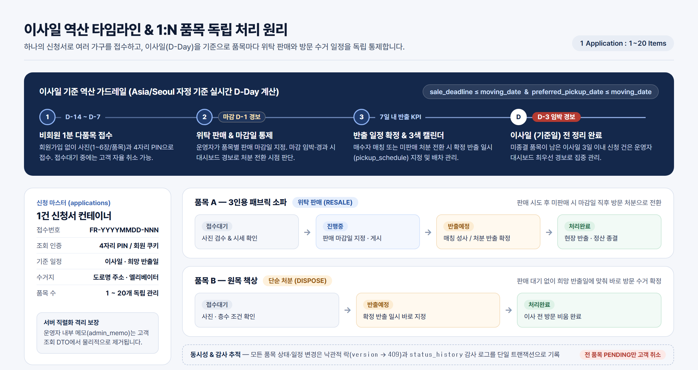
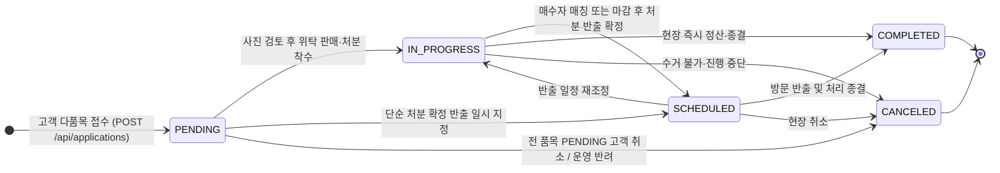
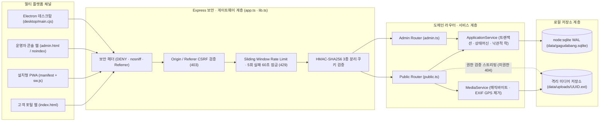
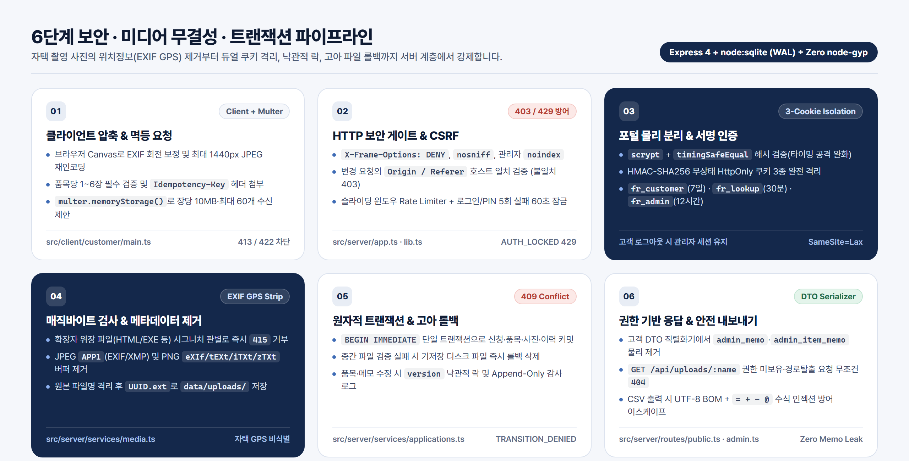
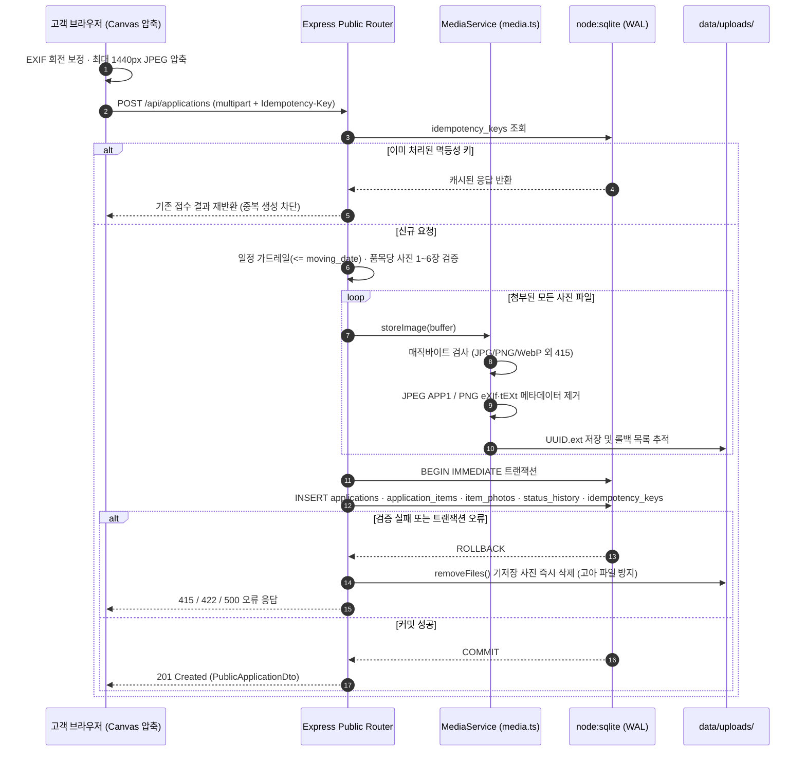
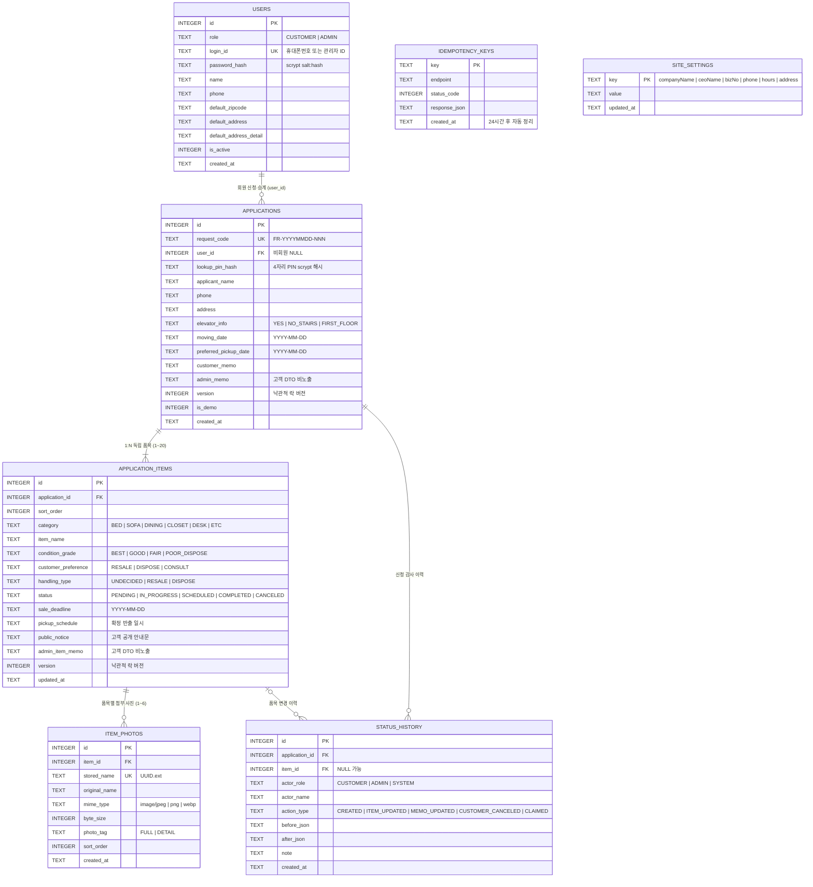

<p align="center">
  
</p>

<h1 align="center">가구다방 (GaguDabang)</h1>

<p align="center">
  <strong>이사 전 가구, 먼저 팔고 남은 건 비워 드립니다.</strong><br>
  이사일 역산 타임라인 기반 중고가구 위탁 판매 및 방문 수거(비움) 리빙 플랫폼 MVP
</p>

<p align="center">
  <a href="#1-서비스-동작-원리">동작 원리</a> &middot;
  <a href="#2-시스템-아키텍처">시스템 아키텍처</a> &middot;
  <a href="#3-보안--미디어-무결성-파이프라인">보안 파이프라인</a> &middot;
  <a href="#4-데이터베이스-er-다이어그램">ER 다이어그램</a> &middot;
  <a href="#5-rest-api-구성">REST API</a> &middot;
  <a href="#6-빠른-실행-가이드">빠른 실행</a>
</p>

---

이사 전 처치 곤란한 대형가구를 **이사일(D-Day) 기준으로 역산**하여 먼저 **위탁 판매 대행**을 연결하고, 마감일까지 미판매된 가구나 신속 정리가 필요한 가구는 희망 반출일에 **방문 수거(비움)**까지 한 번에 처리하는 무번들러 풀스택 웹 플랫폼입니다.

- **핵심 철학**: 회원가입 없는 비회원 1분 다품목 접수(4자리 PIN 조회) · 1건 신청 대비 1~20개 품목 독립 상태머신 · 서버 직렬화 단 비공개 메모 원천 격리
- **무충돌 순수 웹 표준**: 번들러(Webpack/Next.js)와 네이티브 C++ 빌드(`node-gyp`) 의존성 0개 — `tsc` + `Express 4` + Node 내장 `node:sqlite (WAL)`만으로 웹·PWA·Electron 동시 구동
- **디자인 시스템**: 남색(`#14284B`)·흰색(`#F5F7FB`) 베이스 팔레트 + 자체 호스팅 `Pretendard` 단일 글꼴(라이트/다크 모드 지원)

---

## 1. 서비스 동작 원리

### 이사일 역산 타임라인 & 1:N 품목 독립 처리

고객이 한 번의 신청서(`applications`)에 침대·소파·책상 등 최대 20개의 가구를 함께 접수하면, 운영자는 품목(`application_items`)마다 **위탁 판매(`RESALE`)** 또는 **단순 처분(`DISPOSE`)**을 독립적으로 판정합니다. 모든 판매 마감일과 희망 반출일은 서버와 클라이언트 양쪽에서 `이사일 이하` 가드레일로 통제됩니다.



### 품목별 상태 전이 머신 (`src/shared/types.ts`)

신청 건의 실제 진행은 개별 가구 품목 단위로 동작하며, 정의된 전이표(`TRANSITIONS`) 외의 변경은 서버가 `409 TRANSITION_DENIED`로 차단합니다. 고객 자율 취소는 신청 내 **모든 품목이 `PENDING` 상태일 때만** 허용됩니다.



---

## 2. 시스템 아키텍처

고객 포털(`public/index.html`)과 운영자 콘솔(`public/admin.html`)은 HTML 엔트리, 스타일시트, 스크립트, 서명 세션 쿠키(`fr_customer` / `fr_lookup` / `fr_admin`)가 물리적으로 분리되어 있으며 단일 Express 서버에서 서빙됩니다.



---

## 3. 보안 · 미디어 무결성 파이프라인

자택 실내에서 촬영한 가구 사진의 위치정보(EXIF GPS) 노출, 확장자 위장 악성 파일 업로드, 중복 접수, 동시 수정 충돌, 비공개 운영 메모 유출을 6단계 서버 파이프라인으로 방어합니다.



### 다품목 신청 · 사진 무결성 검증 · 고아 파일 롤백 시퀀스



---

## 4. 데이터베이스 ER 다이어그램

Node 내장 `node:sqlite` (`PRAGMA journal_mode = WAL`, `PRAGMA foreign_keys = ON`) 기반의 7개 정규화 테이블 구조입니다([src/server/db.ts](src/server/db.ts)).



---

## 5. REST API 구성

실제 구현된 API 라우트([src/server/routes/public.ts](src/server/routes/public.ts), [src/server/routes/admin.ts](src/server/routes/admin.ts)) 목록입니다.

| 영역 | Method · Path | 인증 / 쿠키 | 핵심 기능 및 보호 규칙 |
| --- | --- | --- | --- |
| **시스템** | `GET /api/health` | 공개 | 서버 헬스체크 |
| **공개 설정** | `GET /api/public/config` | 공개 | 푸터 사업자·고객센터 정보 조회 |
| **접수** | `POST /api/applications` | 공개 / 회원 | `Idempotency-Key` 중복 차단, 사진 1~6장/품목 매직바이트·EXIF 제거, 원자적 생성 |
| **조회/취소** | `POST /api/applications/lookup` | PIN (5회 잠금) | 접수번호/연락처 + 4자리 PIN 검증 후 `fr_lookup`(30분) 발급, 비공개 메모 제외 반환 |
| **조회/취소** | `POST /api/applications/:code/cancel` | 본인(회원/PIN) | 전 품목 `PENDING` 시에만 취소 허용(진행 중 `409 TRANSITION_DENIED`) |
| **미디어** | `GET /api/uploads/:storedName` | 관리자 / 본인 | UUID 패턴 검증 + 권한 확인 후 스트리밍(미권한·경로탈출 무조건 `404`) |
| **고객 회원** | `GET /api/auth/me` · `POST /api/auth/{signup,login,logout}` | `fr_customer` (7일) | `scrypt` 인증, 회원 쿠키 발급/해제(관리자 쿠키 독립 유지) |
| **마이페이지** | `GET /api/my/applications` · `PATCH /api/my/profile` · `POST /api/my/claim` | `fr_customer` | 내 이력 조회, 기본 수거지 수정, 비회원 신청 건(접수번호+PIN) 계정 승계 |
| **관리자 인증** | `POST /api/admin/login` · `POST /api/admin/logout` | `fr_admin` (12시간) | 타이밍 공격 완화 `scrypt` 검증, 5회 실패 60초 잠금(`429 AUTH_LOCKED`) |
| **운영 대시보드** | `GET /api/admin/applications` · `GET /api/admin/schedule` | `fr_admin` | 4대 실시간 KPI, 필터·검색·정렬·페이징, 월간 3색 일정 캘린더 집계 |
| **상세/처리** | `GET / PATCH /api/admin/applications/:id` · `PATCH /api/admin/items/:itemId` | `fr_admin` | 내부 메모 및 품목 상태·마감일·반출일 갱신(`version` `409` 낙관적 락 + 감사 로그) |
| **내보내기/설정** | `GET /api/admin/export/csv` · `PATCH /api/admin/settings` | `fr_admin` | UTF-8 BOM + 수식 인젝션 방어 CSV 다운로드, 비밀번호 및 공개 사업자 정보 변경 |

---

## 6. 빠른 실행 가이드

### 실서버 웹앱 실행 (`Node.js` + 내장 `node:sqlite`)

```bash
# 1. 의존성 설치
npm install

# 2. 서버 + 클라이언트 빌드 및 실행
npm start
```

- **고객 포털**: `http://localhost:<PORT>/` (`public/index.html`)
- **운영자 콘솔**: `http://localhost:<PORT>/admin.html` (`public/admin.html`, `noindex`)
- **Electron 데스크탑 실행**: `npm run desktop` (`desktop/main.cjs`)
- **실배포 필수 환경변수**:
  - `PORT`: 서버 포트 (기본 `3000`)
  - `ADMIN_ID` / `ADMIN_PASSWORD`: 운영자 초기 계정·비밀번호 (**실배포 전 반드시 환경변수로 지정**)
  - `SESSION_SECRET`: HMAC 세션 쿠키 서명 비밀키 (**실배포 전 무작위 비밀키 지정**)

### 타입 검사 · 자동화 테스트 · 성능 측정

```bash
# 서버 · 클라이언트 · 테스트 전체 strict 타입 검사
npm run check

# 자동화 테스트 (46개 통과: API 32 + 보안·미디어 6 + 시간 의존 8)
npm test

# 성능 벤치마크 (500건 · 5,000건 기준 p95 측정)
npm run perf
```

### 분리형 정적 프로토타입 (`prototype/`, 진행중)

고객 웹([prototype/customer.html](prototype/customer.html))과 관리자 웹(`prototype/admin.html`, 예정)을 6단계로 분리 제작 중입니다. 현재 1~3단계(유사 앱 분석·관리자 구성요소 기획·`prototype/tokens.css` 확정 및 CC 라이선스 가구 사진 7종 배치)를 마치고 4단계(고객 웹) 구현 중입니다.

---

## 7. 진행 현황 · 기술 스택 · 디렉터리 구조

### 단계별 진행 현황

상세 이력과 잔여 항목은 [docs/DEVELOPMENT_STATUS.md](docs/DEVELOPMENT_STATUS.md)와 [docs/프로토타입_분리_기획안.md](docs/프로토타입_분리_기획안.md)에서 관리합니다.

| 단계 / TASK | 내용 | 상태 | 주요 산출물 |
| --- | --- | :---: | --- |
| `DOC-01` | 국내 7개 플랫폼 벤치마킹, 서비스 종합 설계기획서·상세 기술 기획서 작성 | **완료** | `docs/*.md`, `docs/*.pdf`, `docs/assets/design/*.svg` |
| `TASK-01` / `R1` | 「가구다방」 리브랜딩 및 인터랙티브 프로토타입 제작 | **완료** | `docs/assets/brand/*.svg` (내부 데모본 별도 보관) |
| `TASK-02` | 실서버 백엔드(`Express + TypeScript + node:sqlite`) DB·인증·보안·REST API 18종 | **완료** | `src/shared/*`, `src/server/*` |
| `TASK-03` | 실서버 무번들러 프론트엔드(고객 포털·관리자 콘솔)·PWA·Electron 연동 | **진행중 (부분 완료)** | `public/*`, `src/client/*`, `desktop/main.cjs` |
| `TASK-04` | 자동화 테스트(`node:test` 46개)·성능 측정(`500`/`5,000`건) 및 품질 검수 | **부분 완료** | `tests/*.test.ts`, `scripts/perf.ts` |
| **프로토타입 분리** | 고객 웹(`customer.html`)·관리자 웹(`admin.html`) 6단계 정적 프로토타입 분리 | **진행중 (4단계 착수)** | `prototype/*`, [docs/프로토타입_분리_기획안.md](docs/프로토타입_분리_기획안.md) |

### 확정 기술 스택

| 계층 | 확정 기술 | 핵심 선정 사유 |
| --- | --- | --- |
| **프론트엔드** | `HTML5` + `CSS3 (디자인 토큰)` + `Vanilla TypeScript (ES2022 Modules)` | 무거운 번들러 의존성 0개, 공식 `tsc`만으로 표준 브라우저 모듈 컴파일 |
| **백엔드** | `Node.js` + `Express 4` + `TypeScript (strict)` + `multer 2.5` | 단일 서버에서 REST API 18종 및 고객(`index.html`)·운영자(`admin.html`) 물리 격리 서빙 |
| **데이터베이스** | Node 내장 `node:sqlite` (`DatabaseSync`, WAL 모드) | C++ 빌드(`node-gyp`) 없이 Windows/Linux 환경에서 즉시 구동 |
| **보안·미디어** | `node:crypto (scrypt)`, 매직바이트 검증, 버퍼 단위 EXIF 제거 | 자택 촬영 사진 위치정보 자동 삭제, 비공개 운영 메모 서버 단 차단 |
| **멀티 플랫폼** | `PWA (manifest.webmanifest + Service Worker)` + `Electron 45` | 동일 웹 코드로 모바일/PC 설치형 웹앱 및 운영자 데스크탑 앱 동시 지원 |

### 디렉터리 구조

```text
gagudabang/
├── README.md                              # 프로젝트 안내·아키텍처·파이프라인·ERD 문서
├── package.json                           # 빌드·실행·테스트·성능 스크립트 및 의존성
├── tsconfig.{base,server,client,test}.json
├── src/
│   ├── shared/types.ts                    # 프론트·백엔드 공용 타입 및 상태 전이 계약
│   ├── server/                            # Express + node:sqlite 백엔드 (API 18종)
│   │   ├── index.ts / app.ts / db.ts / lib.ts
│   │   ├── routes/{public.ts, admin.ts}
│   │   └── services/{applications.ts, media.ts}
│   └── client/                            # Vanilla TypeScript 프론트엔드
│       ├── common/{api.ts, ui.ts}
│       ├── customer/{main.ts, legal.ts}
│       └── admin/main.ts
├── public/                                # 실서버 정적 엔트리·스타일·PWA·자체 호스팅 폰트
│   ├── index.html / admin.html / manifest.webmanifest / sw.js
│   ├── styles/{tokens.css, customer.css, admin.css, responsive.css}
│   └── assets/{brand/icon.svg, fonts/PretendardVariable.woff2}
├── prototype/                             # 분리형 정적 프로토타입 (4단계 고객 웹 진행중)
│   ├── customer.{html,css,js} / tokens.css / base.css / ui.css / data.js / store.js
│   └── assets/{icon.svg, fonts/, photos/}
├── desktop/main.cjs                       # Electron 운영자 데스크탑 래퍼
├── tests/                                 # node:test 자동화 테스트 스위트 (46개)
│   └── {api.test.ts, security-media.test.ts, time.test.ts, helpers.ts}
├── scripts/perf.ts                        # 500건 / 5,000건 성능 벤치마크 스크립트
└── docs/                                  # 기획서·벤치마킹·진행 현황 및 README 시각 자산
    ├── DEVELOPMENT_STATUS.md              # 단계별 개발 진행 현황 및 잔여 항목
    ├── 프로토타입_분리_기획안.md              # 고객/관리자 분리 프로토타입 기획안 및 기준안
    ├── 기술_상세_기획서.{md,pdf}            # 화면·기능·SQL DDL·API 18종 상세 기술 기획서
    ├── 서비스_종합_설계기획서.md              # 서비스 종합 설계기획서 마크다운
    ├── 국내_플랫폼_분석/                    # 국내 7개 유사 플랫폼 벤치마킹 분석서 (MD/PDF)
    └── assets/
        ├── brand/                         # 브랜드 아이콘·가로형 로고 SVG
        ├── design/                        # 공개용 설계 도식 SVG
        └── readme/                        # README 배너·역산 원리·보안 파이프라인 고해상도 PNG
```

> **공개 저장소 보안 정책**: 계약·견적 문서, 사업자/개인정보가 포함된 원본 시안·파일, 로컬 `.env` 및 SQLite DB 파일은 [.gitignore](.gitignore)로 제외되어 있습니다.
