# 가구다방 — 고객 이용 가이드

[가이드 목차](README.md) · [관리자 이용 가이드](관리자_이용_가이드.md)

이사 전에 가구를 맡기고, 진행 상황을 확인하는 방법을 처음부터 차례로 안내합니다. 화면 그림에 **빨간 번호**를 붙여, 어디를 누르면 되는지 그대로 따라 할 수 있게 했습니다.

> [!NOTE]
> 그림 속 이름·주소·전화번호는 설명용 예시입니다. 버튼과 칸의 위치와 이름은 실제 화면과 같습니다.

---

## 이 가이드로 할 수 있는 일

| 하고 싶은 일 | 읽을 곳 |
| --- | --- |
| 화면이 어떻게 생겼는지 보고 싶다 | [1. 첫 화면 보기](#1-첫-화면-보기) |
| 가구를 맡기고 싶다 | [2. 가구 접수하기](#2-가구-접수하기) |
| 접수한 뒤 무엇을 기억해야 하는지 알고 싶다 | [3. 접수 완료와 접수번호](#3-접수-완료와-접수번호) |
| 진행 상황을 보거나 접수를 취소하고 싶다 | [4. 진행 조회와 취소](#4-진행-조회와-취소) |
| "진행중", "반출예정"이 무슨 뜻인지 알고 싶다 | [5. 진행 상태 읽는 법](#5-진행-상태-읽는-법) |
| 회원으로 가입하거나 로그인하고 싶다 | [6. 회원가입과 로그인](#6-회원가입과-로그인) |
| 내 접수를 한곳에서 보고 싶다 | [7. 마이페이지](#7-마이페이지) |
| 휴대폰으로 쓰고 싶다 | [8. 휴대폰에서 쓰기](#8-휴대폰에서-쓰기) |
| 궁금한 점이 있다 | [9. 자주 묻는 질문](#9-자주-묻는-질문) |

---

## 먼저 알아두세요: 회원가입 없이도 접수할 수 있어요

| | 회원가입 없이 | 회원으로 로그인하면 |
| --- | --- | --- |
| 가구 접수 | 가능 (한 번에 가구 1~20개) | 가능. 이름과 기본 수거지가 **자동으로 채워짐** |
| 진행 조회 | **접수번호(또는 연락처) + PIN 4자리**로 조회 | **마이페이지**에서 PIN 없이 한 번에 확인 |
| 접수 취소 | 진행 조회 화면에서 가능 | 마이페이지에서 가능 |
| 예전 접수 모아 보기 | 접수마다 따로 조회 | 접수번호와 PIN으로 **내 계정에 연결**해 모아 보기 |

---

## 1. 첫 화면 보기

주소창에 안내받은 주소를 입력하면 첫 화면이 열립니다.

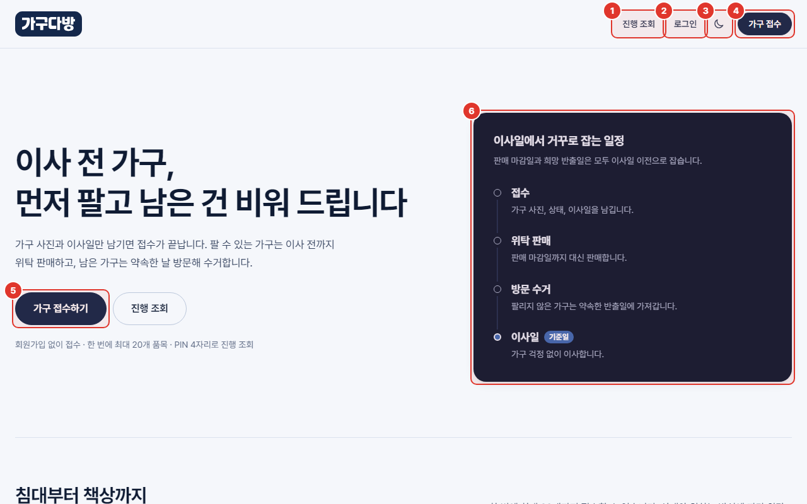

| 번호 | 이름 | 하는 일 |
| :---: | --- | --- |
| **1** | 진행 조회 | 접수한 가구가 어디까지 진행됐는지 봅니다. |
| **2** | 로그인 | 회원 로그인 화면으로 갑니다. 로그인하면 이 자리에 내 이름과 **로그아웃**이 나옵니다. |
| **3** | 달 모양 버튼 | 화면을 **어두운 색**으로 바꿉니다. 다시 누르면 원래대로 돌아옵니다. |
| **4** | 가구 접수 | 가구를 맡기는 화면으로 갑니다. 어느 화면에서든 위쪽에 있습니다. |
| **5** | 가구 접수하기 | 4번과 같은 화면으로 갑니다. |
| **6** | 이사일에서 거꾸로 잡는 일정 | 접수 → 위탁 판매 → 방문 수거 → 이사일 순서를 보여 줍니다. 판매 마감일과 반출일은 모두 **이사일 이전**으로 잡습니다. |

아래로 내리면 맡길 수 있는 가구 종류, 세 가지 처리 방식(위탁 판매, 단순 처분, 상담 후 결정), 자주 묻는 질문이 이어집니다.

---

## 2. 가구 접수하기

**가구 접수**를 누르면 접수 화면이 나옵니다. 위에서 아래로 차례로 채우면 됩니다. `(선택)`이라고 적히지 않은 칸은 꼭 입력해야 합니다.

### 신청자, 수거 장소, 일정

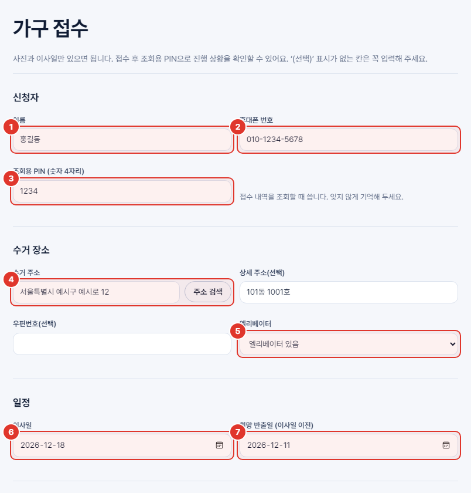

| 번호 | 칸 이름 | 어떻게 쓰나요 |
| :---: | --- | --- |
| **1** | 이름 | 신청하는 분의 이름을 씁니다. |
| **2** | 휴대폰 번호 | 연락받을 번호입니다. `010-1234-5678`처럼 쓰거나 숫자만 써도 됩니다. |
| **3** | 조회용 PIN | **숫자 4자리**를 직접 정합니다. 나중에 진행 상황을 볼 때 씁니다. **꼭 기억해 두세요.** |
| **4** | 수거 주소 | **주소 검색**을 눌러 찾거나 직접 씁니다. 옆 칸에 동·호수(상세 주소)를 적습니다. |
| **5** | 엘리베이터 | **있음 / 없음(계단) / 1층** 중에서 고릅니다. 가구를 옮기는 방법을 정하는 데 씁니다. |
| **6** | 이사일 | 이사하는 날짜를 고릅니다. 오늘이나 그 뒤의 날짜만 고를 수 있습니다. |
| **7** | 희망 반출일 | 가구를 가져가기 원하는 날짜입니다. **이사일과 같거나 그보다 앞선 날짜**여야 합니다. |

### 맡길 가구와 사진

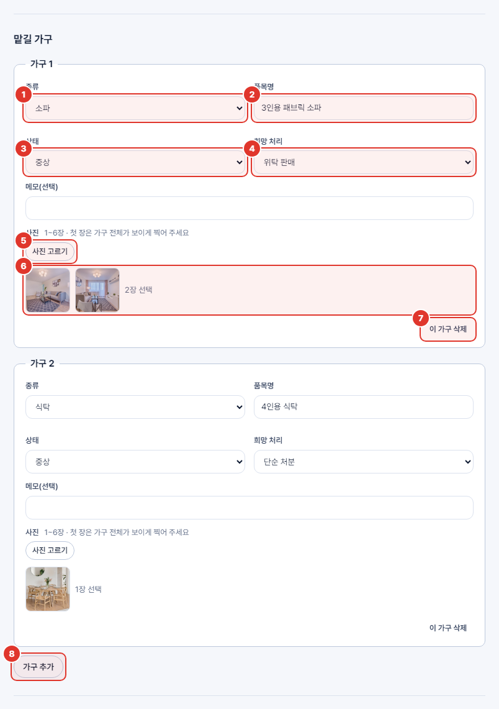

| 번호 | 이름 | 어떻게 쓰나요 |
| :---: | --- | --- |
| **1** | 종류 | **침대 / 소파 / 식탁 / 옷장·수납 / 책상 / 기타** 중에서 고릅니다. |
| **2** | 품목명 | 어떤 가구인지 짧게 씁니다. 예: "3인용 패브릭 소파" |
| **3** | 상태 | **상 / 중상 / 중 / 하(처분 희망)** 중에서 고릅니다. |
| **4** | 희망 처리 | **위탁 판매**(대신 팔아 주기), **단순 처분**(팔지 않고 수거), **상담 후 결정** 중에서 고릅니다. |
| **5** | 사진 고르기 | 가구 사진을 **1장에서 6장까지** 올립니다. 첫 장은 가구 전체가 보이게 찍어 주세요. |
| **6** | 고른 사진 | 올릴 사진이 작게 보입니다. 다시 고르려면 5번을 한 번 더 누릅니다. |
| **7** | 이 가구 삭제 | 잘못 추가한 가구 칸을 지웁니다. |
| **8** | 가구 추가 | 가구를 하나 더 적습니다. 한 번에 **20개까지** 접수할 수 있고, 가구마다 처리 방식을 따로 고를 수 있습니다. |

> [!TIP]
> 사진은 휴대폰으로 찍은 그대로 올려도 됩니다. 올릴 때 크기를 알아서 줄이고, 사진에 들어 있는 **촬영 위치 정보는 지운 뒤 저장**합니다.

### 요청 사항, 동의, 접수

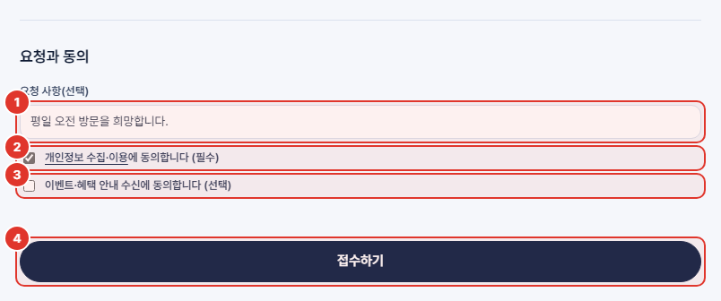

| 번호 | 이름 | 하는 일 |
| :---: | --- | --- |
| **1** | 요청 사항 (선택) | 방문 시간처럼 미리 알리고 싶은 내용을 씁니다. |
| **2** | 개인정보 수집·이용 동의 (필수) | 체크해야 접수됩니다. 파란 글자를 누르면 내용을 볼 수 있습니다. |
| **3** | 이벤트·혜택 안내 수신 (선택) | 원할 때만 체크합니다. 체크하지 않아도 접수됩니다. |
| **4** | 접수하기 | 누르면 접수됩니다. 빠뜨린 칸이 있으면 그 칸 아래에 **빨간 글씨**로 알려 주고 그 칸으로 이동합니다. |

---

## 3. 접수 완료와 접수번호

접수가 끝나면 아래 화면이 나옵니다.

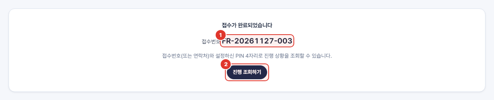

| 번호 | 이름 | 하는 일 |
| :---: | --- | --- |
| **1** | 접수번호 | `FR-날짜-순번` 모양입니다. **적어 두거나 화면을 찍어 두세요.** |
| **2** | 진행 조회하기 | 방금 접수한 내용을 바로 확인하러 갑니다. |

> [!IMPORTANT]
> 접수번호를 잊어도 **접수할 때 쓴 휴대폰 번호와 PIN**으로 조회할 수 있습니다. PIN은 다시 알려 드릴 수 없으니 꼭 기억해 두세요.

---

## 4. 진행 조회와 취소

위쪽의 **진행 조회**를 누릅니다.

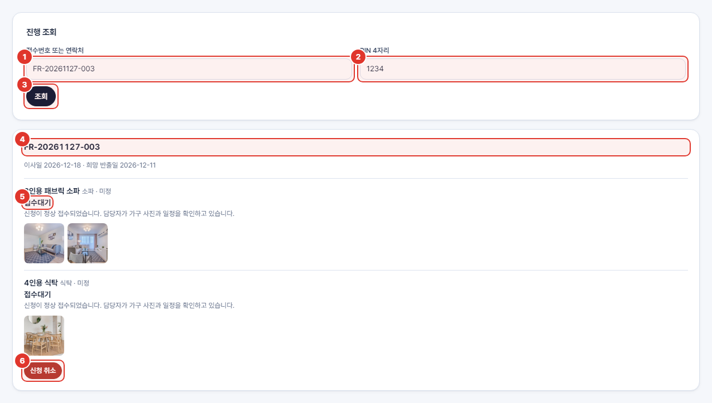

| 번호 | 이름 | 하는 일 |
| :---: | --- | --- |
| **1** | 접수번호 또는 연락처 | 접수번호나 접수할 때 쓴 휴대폰 번호를 씁니다. 휴대폰 번호로 조회하면 그 번호와 PIN이 같은 접수가 모두 나옵니다. |
| **2** | PIN 4자리 | 접수할 때 정한 숫자 4자리를 씁니다. |
| **3** | 조회 | 누르면 아래에 결과가 나옵니다. |
| **4** | 접수번호 | 조회된 접수입니다. 아래에 이사일과 희망 반출일이 보입니다. |
| **5** | 상태 | 가구마다 지금 상태가 굵은 글씨로 보입니다. 뜻은 [5번](#5-진행-상태-읽는-법)에 있습니다. |
| **6** | 신청 취소 | **모든 가구가 "접수대기"일 때만** 보입니다. 누르고 확인하면 접수 전체가 취소됩니다. |

> [!WARNING]
> PIN을 **5번 연속으로 틀리면 1분 동안** 조회가 막힙니다. 잠시 기다렸다가 다시 해 보세요.

### 담당자가 처리를 시작한 뒤

담당자가 가구를 확인하고 처리를 시작하면 조회 화면이 아래처럼 바뀝니다.

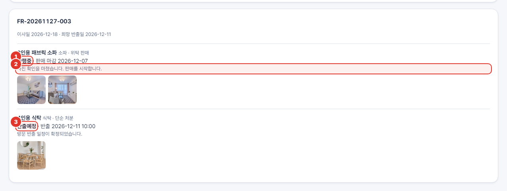

| 번호 | 이름 | 하는 일 |
| :---: | --- | --- |
| **1** | 상태와 날짜 | 위탁 판매 중이면 **판매 마감일**이, 반출이 정해지면 **반출 날짜와 시간**이 옆에 나옵니다. |
| **2** | 안내문 | 담당자가 남긴 안내입니다. |
| **3** | 다른 가구의 상태 | 가구마다 따로 진행됩니다. 하나는 판매 중이고 다른 하나는 반출 날짜가 잡힐 수 있습니다. |

처리가 시작되면 **신청 취소** 버튼이 사라집니다. 그 뒤에 취소하려면 고객센터로 문의해 주세요.

---

## 5. 진행 상태 읽는 법

| 상태 | 뜻 | 내가 할 일 |
| --- | --- | --- |
| **접수대기** | 접수됐고, 담당자가 사진과 일정을 확인하기 전입니다. | 기다립니다. 이때는 직접 취소할 수 있습니다. |
| **진행중** | 위탁 판매 또는 처분을 진행하고 있습니다. | 판매 마감일을 확인합니다. |
| **반출예정** | 방문해서 가구를 가져갈 날짜와 시간이 정해졌습니다. | 그 시간에 가구를 가져갈 수 있게 준비합니다. |
| **처리완료** | 반출과 처리가 모두 끝났습니다. | 할 일이 없습니다. |
| **취소·반려** | 고객이 취소했거나 담당자가 접수를 받지 못했습니다. | 안내문에서 이유를 확인합니다. |

---

## 6. 회원가입과 로그인

회원가입은 꼭 하지 않아도 됩니다. 가입하면 접수할 때 이름과 주소가 자동으로 채워지고, 접수 내역을 한곳에서 볼 수 있습니다.

### 회원가입

위쪽 **로그인**을 누른 뒤 **회원가입**을 누릅니다.

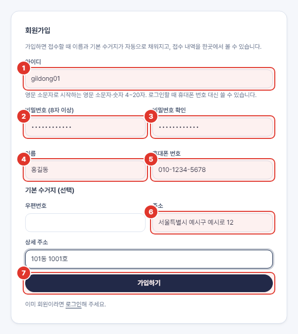

| 번호 | 이름 | 어떻게 쓰나요 |
| :---: | --- | --- |
| **1** | 아이디 | **영문 소문자로 시작**하는 영문 소문자·숫자 4~20자. 예: `gildong01` |
| **2** | 비밀번호 | 8자 이상. |
| **3** | 비밀번호 확인 | 같은 비밀번호를 한 번 더 씁니다. |
| **4** | 이름 | 접수할 때 자동으로 채워집니다. |
| **5** | 휴대폰 번호 | 로그인할 때 아이디 대신 쓸 수도 있습니다. 한 번호로 한 번만 가입할 수 있습니다. |
| **6** | 기본 수거지 (선택) | 적어 두면 접수할 때 주소가 자동으로 채워집니다. |
| **7** | 가입하기 | 누르면 가입되고 **바로 로그인**됩니다. |

### 로그인

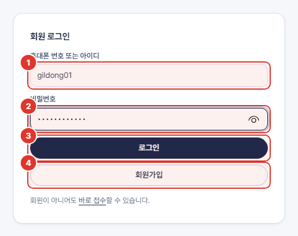

| 번호 | 이름 | 하는 일 |
| :---: | --- | --- |
| **1** | 휴대폰 번호 또는 아이디 | 가입할 때 쓴 **휴대폰 번호나 아이디** 중 하나를 씁니다. |
| **2** | 비밀번호 | 비밀번호를 씁니다. 글자는 점으로 가려집니다. |
| **3** | 로그인 | 누르면 마이페이지로 갑니다. |
| **4** | 회원가입 | 아직 계정이 없으면 누릅니다. |

---

## 7. 마이페이지

로그인하면 위쪽에 내 이름이 나옵니다. 이름을 누르면 마이페이지가 열립니다.

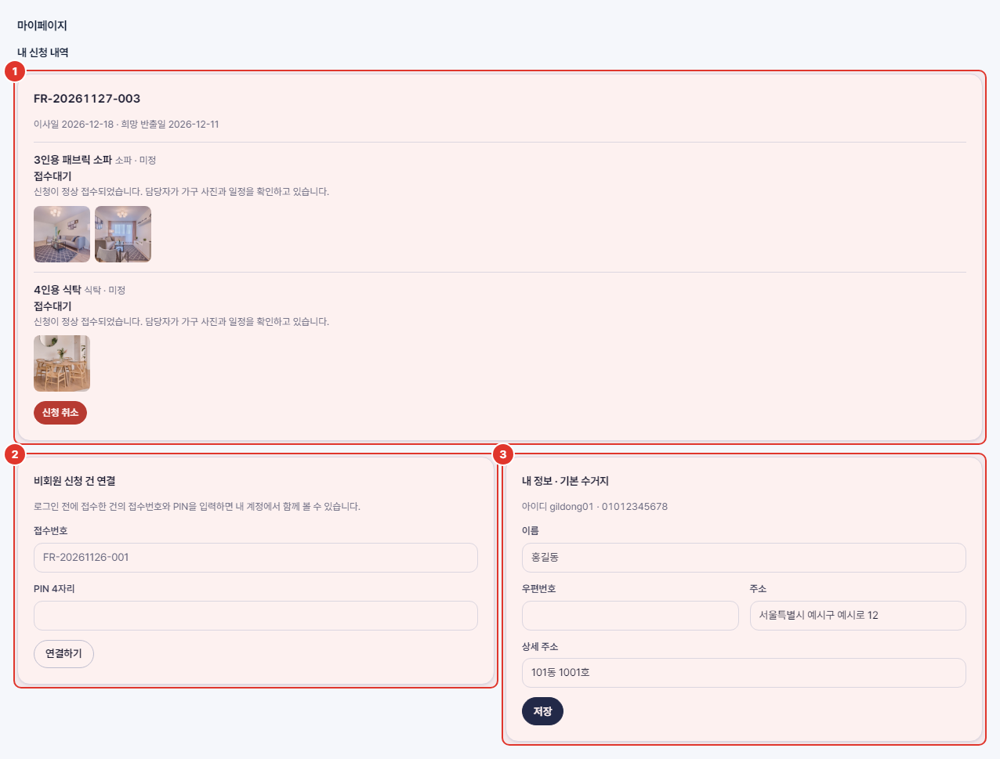

| 번호 | 이름 | 하는 일 |
| :---: | --- | --- |
| **1** | 내 신청 내역 | 내 계정에 연결된 접수가 모두 보입니다. PIN을 쓰지 않아도 됩니다. 모든 가구가 접수대기이면 여기서도 취소할 수 있습니다. |
| **2** | 비회원 신청 건 연결 | 가입하기 전에 접수한 건이 있으면 **접수번호와 PIN**을 넣고 **연결하기**를 누릅니다. 그러면 1번 목록에 들어옵니다. |
| **3** | 내 정보 · 기본 수거지 | 이름과 기본 주소를 고칩니다. 다음 접수부터 이 내용이 자동으로 채워집니다. |
| **4** | 로그아웃 | 다른 사람과 함께 쓰는 기기에서는 쓰고 난 뒤 꼭 눌러 주세요. |

로그인한 상태에서 접수하면 그 접수는 따로 연결하지 않아도 1번 목록에 들어갑니다.

---

## 8. 휴대폰에서 쓰기

휴대폰에서도 같은 주소로 들어가면 화면이 작은 크기에 맞게 바뀝니다. 할 수 있는 일은 컴퓨터와 같습니다.

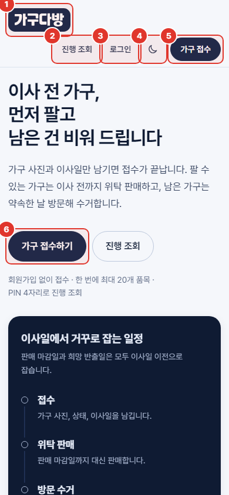

| 번호 | 이름 | 하는 일 |
| :---: | --- | --- |
| **1** | 가구다방 로고 | 어느 화면에서든 누르면 첫 화면으로 돌아옵니다. |
| **2** | 진행 조회 | 접수한 가구의 진행 상황을 봅니다. |
| **3** | 로그인 | 회원 로그인 화면으로 갑니다. |
| **4** | 달 모양 버튼 | 화면을 어두운 색으로 바꿉니다. |
| **5** | 가구 접수 | 접수 화면으로 갑니다. |
| **6** | 가구 접수하기 | 5번과 같습니다. |

### 휴대폰으로 접수하기

칸이 한 줄에 하나씩 세로로 놓입니다. **사진 고르기**를 누르면 휴대폰의 사진첩이나 카메라에서 바로 고를 수 있습니다.

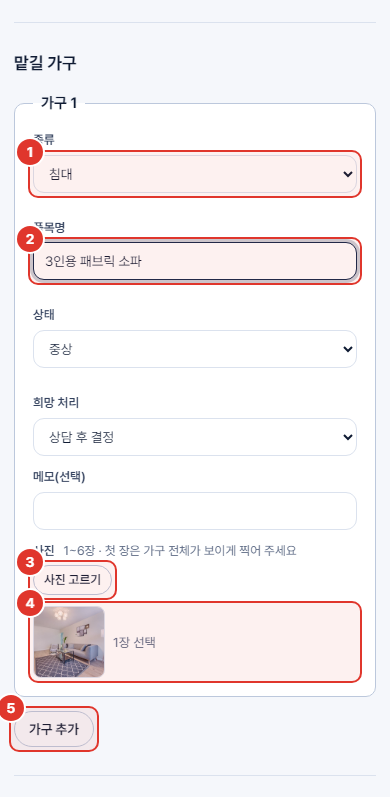

| 번호 | 이름 | 하는 일 |
| :---: | --- | --- |
| **1** | 종류 | 가구 종류를 고릅니다. |
| **2** | 품목명 | 어떤 가구인지 씁니다. |
| **3** | 사진 고르기 | 사진첩에서 고르거나 바로 찍습니다. |
| **4** | 고른 사진 | 올릴 사진이 작게 보입니다. |
| **5** | 가구 추가 | 가구를 하나 더 적습니다. |

### 휴대폰으로 조회하기

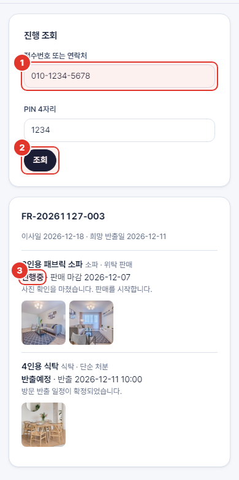

| 번호 | 이름 | 하는 일 |
| :---: | --- | --- |
| **1** | 접수번호 또는 연락처 | 접수번호를 몰라도 **휴대폰 번호**를 쓰면 됩니다. |
| **2** | 조회 | PIN을 쓰고 누릅니다. |
| **3** | 상태 | 가구마다 상태와 날짜가 보입니다. |

---

## 9. 자주 묻는 질문

**Q. 접수번호를 잊어버렸어요.**
진행 조회 화면에서 접수번호 대신 **접수할 때 쓴 휴대폰 번호**를 쓰고 PIN을 넣으면 됩니다.

**Q. PIN을 잊어버렸어요.**
PIN은 다시 알려 드릴 수 없게 저장됩니다. 고객센터로 문의해 주세요.

**Q. 접수한 뒤에 내용을 고치고 싶어요.**
고객 화면에서는 고칠 수 없습니다. 모든 가구가 접수대기라면 **취소한 뒤 다시 접수**하면 됩니다. 처리가 시작됐다면 고객센터로 문의해 주세요.

**Q. 신청 취소 버튼이 보이지 않아요.**
가구 중 하나라도 처리가 시작되면(진행중·반출예정 등) 버튼이 사라집니다. 고객센터로 문의해 주세요.

**Q. 사진이 올라가지 않아요.**
JPG, PNG, WebP 사진만 올릴 수 있고 가구 하나에 6장까지입니다. 사진이 아주 많으면 가구를 나눠서 두 번에 접수해 보세요.

**Q. 희망 반출일을 이사일 뒤로 잡을 수 있나요?**
아니요. 가구는 이사 전에 정리하는 것이 원칙이라 **이사일과 같거나 앞선 날짜**만 고를 수 있습니다.

**Q. 판매 마감일까지 팔리지 않으면 어떻게 되나요?**
접수할 때 고른 방식과 담당자와 상의한 내용에 따라 처리합니다. 바뀐 내용은 진행 조회 화면의 상태와 안내문에서 확인할 수 있습니다.

**Q. 회원가입을 하면 예전에 접수한 것도 보이나요?**
자동으로는 보이지 않습니다. 마이페이지의 **비회원 신청 건 연결**에 접수번호와 PIN을 넣으면 내 계정에 들어옵니다.
