# 가구다방 — 관리자 이용 가이드

[가이드 목차](README.md) · [고객 이용 가이드](고객_이용_가이드.md)

고객이 접수한 가구를 확인하고, 처리 방식과 일정을 정해 끝까지 처리하는 방법을 안내합니다. 화면 그림에 **빨간 번호**를 붙여 설명했습니다.

> [!NOTE]
> 그림 속 이름·주소·전화번호는 설명용 예시입니다. 버튼과 칸의 위치와 이름은 실제 화면과 같습니다.

---

## 업무 흐름 한눈에 보기

| 순서 | 하는 일 | 읽을 곳 |
| :---: | --- | --- |
| 1 | 로그인한다 | [1. 로그인](#1-로그인) |
| 2 | 새로 들어온 접수와 급한 접수를 찾는다 | [2. 접수 목록 보기](#2-접수-목록-보기) |
| 3 | 접수를 열어 신청 내용과 사진을 본다 | [3. 접수 열어보기](#3-접수-열어보기) · [7. 사진 크게 보기](#7-사진-크게-보기와-변경-이력) |
| 4 | 가구마다 처리 방식, 상태, 날짜를 정한다 | [4. 가구별로 처리하기](#4-가구별로-처리하기) · [5. 상태 바꾸기와 확인](#5-상태-바꾸기와-확인) |
| 5 | 고객에게 알린다 | [6. 문자 문구](#6-문자-문구) |
| 6 | 날짜별 일정을 확인하고 필요한 일정을 직접 넣는다 | [8. 일정 보기](#8-일정-보기) |
| 7 | 방문과 접수를 기간별로 본다 | [9. 통계 보기](#9-통계-보기) |

상태는 가구마다 따로 움직입니다. 순서는 아래와 같고, 정해진 순서 밖으로는 바꿀 수 없습니다.

| 지금 상태 | 바꿀 수 있는 상태 |
| --- | --- |
| **접수대기** | 진행중, 반출예정, 취소·반려 |
| **진행중** | 반출예정, 처리완료, 취소·반려 |
| **반출예정** | 진행중(일정 다시 잡기), 처리완료, 취소·반려 |
| **처리완료**, **취소·반려** | 바꿀 수 없음 (끝난 상태) |

---

## 1. 로그인

서비스 주소 끝에 `/admin`을 붙여 엽니다.

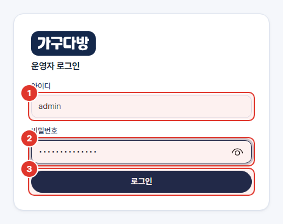

| 번호 | 이름 | 하는 일 |
| :---: | --- | --- |
| **1** | 아이디 | 관리자 아이디를 씁니다. |
| **2** | 비밀번호 | 관리자 비밀번호를 씁니다. |
| **3** | 로그인 | 누르면 접수 목록이 열립니다. |

> [!WARNING]
> 비밀번호를 **5번 연속으로 틀리면 1분 동안** 로그인이 막힙니다. 로그인은 12시간 동안 유지되고, 그 뒤에는 다시 로그인해야 합니다.

---

## 2. 접수 목록 보기

로그인하면 가장 먼저 보이는 화면입니다. 접수는 **이사일이 가까운 순서**로 놓입니다.

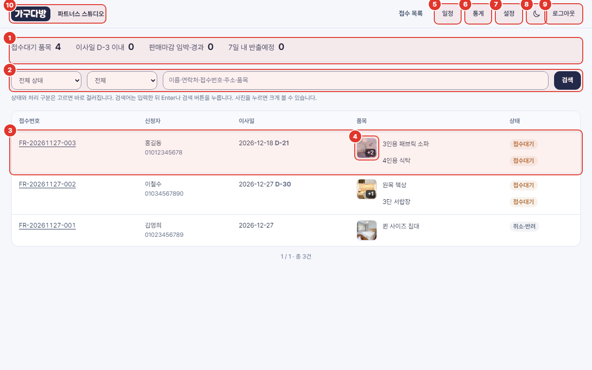

| 번호 | 이름 | 하는 일 |
| :---: | --- | --- |
| **1** | 오늘 확인할 숫자 | **접수대기 품목**(아직 확인하지 않은 가구), **이사일 D-3 이내**(이사가 3일 안으로 다가온 접수), **판매마감 임박·경과**(마감이 내일이거나 지난 가구), **7일 내 반출예정**(일주일 안에 가져갈 가구) 수입니다. 급한 숫자는 빨갛게 보입니다. |
| **2** | 찾기 | **상태나 처리 구분은 고르는 즉시** 목록이 걸러집니다. 이름·연락처·접수번호·주소·품목으로 찾을 때는 검색어를 쓰고 Enter나 **검색**을 누릅니다. |
| **3** | 접수 한 줄 | 접수번호, 신청자와 연락처, 이사일(남은 날 `D-숫자`), 품목, 품목마다의 상태 뱃지가 보입니다. 뱃지 색은 접수대기 주황, 진행중 파랑, 반출예정 남색, 처리완료 초록, 취소·반려 회색입니다. **접수번호를 누르면** 그 접수가 열립니다. |
| **4** | 가구 사진 | 접수마다 첫 사진 한 장이 작게 보입니다(`+2`는 사진이 2장 더 있다는 뜻). **누르면 크게 열리고**, 이전·다음이나 방향키로 그 접수의 모든 가구 사진을 넘겨 봅니다. Esc나 바깥을 누르면 닫힙니다. |
| **5** | 일정 | 날짜별 일정 화면으로 갑니다. |
| **6** | 통계 | 방문자와 접수를 기간별 차트로 봅니다. 접수 목록 CSV 파일도 여기서 내려받습니다. |
| **7** | 설정 | 사업자 정보와 비밀번호를 고칩니다. |
| **8** | 달 모양 버튼 | 화면을 어두운 색으로 바꿉니다. 다시 누르면 원래대로 돌아옵니다. |
| **9** | 로그아웃 | 함께 쓰는 컴퓨터에서는 쓰고 난 뒤 꼭 누릅니다. |
| **10** | 가구다방 로고 | 관리자 홈입니다. 어느 화면에서든 누르면 거르기와 쪽을 처음으로 되돌린 접수 목록이 열립니다. |

접수가 20건을 넘으면 목록 아래에 **이전 / 다음**이 생깁니다.

---

## 3. 접수 열어보기

목록에서 접수번호를 누르면 그 접수의 모든 내용이 한 화면에 나옵니다. 맨 위는 신청 정보입니다.

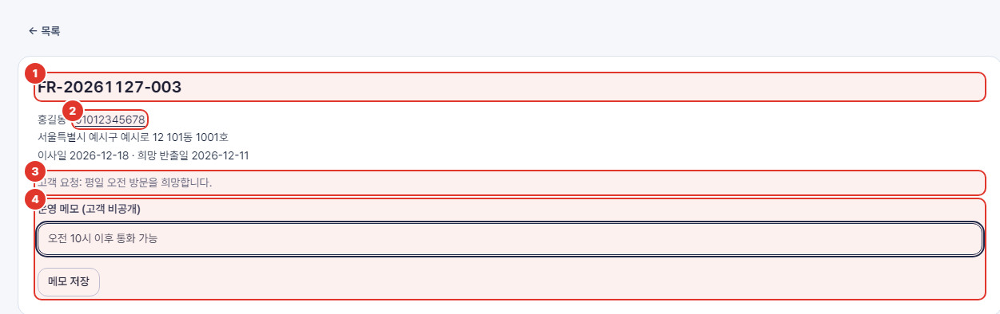

| 번호 | 이름 | 하는 일 |
| :---: | --- | --- |
| **1** | 접수번호 | 지금 보고 있는 접수입니다. 아래에 주소, 이사일, 희망 반출일이 있습니다. |
| **2** | 연락처 | 휴대폰에서 누르면 바로 전화가 걸립니다. |
| **3** | 고객 요청 | 고객이 접수할 때 남긴 요청 사항입니다. |
| **4** | 운영 메모 | 운영자끼리만 보는 메모입니다. **고객에게는 보이지 않습니다.** 쓰고 **메모 저장**을 누릅니다. |

왼쪽 위의 **← 목록**을 누르면 접수 목록으로 돌아갑니다.

---

## 4. 가구별로 처리하기

신청 정보 아래에 가구가 하나씩 칸으로 나옵니다. 가구마다 따로 정하고 따로 저장합니다.

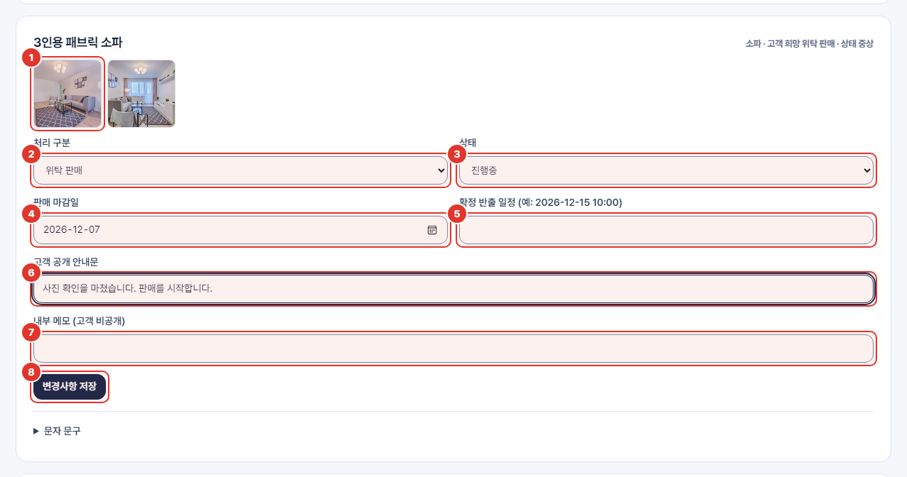

| 번호 | 이름 | 어떻게 쓰나요 |
| :---: | --- | --- |
| **1** | 사진 | 고객이 올린 사진입니다. 누르면 크게 보입니다. ([7번](#7-사진-크게-보기와-변경-이력)) |
| **2** | 처리 구분 | **미정 / 위탁 판매 / 단순 처분** 중에서 정합니다. 칸 위에 고객이 원한 방식이 적혀 있습니다. |
| **3** | 상태 | 지금 상태에서 바꿀 수 있는 상태만 나옵니다. |
| **4** | 판매 마감일 | 위탁 판매일 때 언제까지 팔지 정합니다. **이사일을 넘길 수 없습니다.** |
| **5** | 확정 반출 일정 | 가져갈 날짜와 시간을 `2026-12-15 10:00`처럼 씁니다. 상태를 **반출예정**으로 바꾸려면 꼭 있어야 합니다. |
| **6** | 고객 공개 안내문 | **고객의 진행 조회 화면에 그대로 보이는 글**입니다. 비워 두면 상태에 맞는 기본 문구가 나갑니다. **취소·반려**로 바꿀 때는 이유를 꼭 써야 합니다. |
| **7** | 내부 메모 | 이 가구에 대한 운영자용 메모입니다. 고객에게는 보이지 않습니다. |
| **8** | 변경사항 저장 | 누르면 저장됩니다. 상태를 바꿨다면 먼저 확인 줄이 나옵니다. ([5번](#5-상태-바꾸기와-확인)) |

> [!TIP]
> 다른 운영자가 같은 가구를 먼저 고쳤다면 저장할 때 "다른 관리자가 먼저 변경했습니다"라는 알림이 뜨고 최신 내용으로 다시 불러옵니다. 내용을 확인하고 다시 고치면 됩니다.

---

## 5. 상태 바꾸기와 확인

상태를 바꾸고 **변경사항 저장**을 누르면 바로 저장하지 않고 아래 줄이 먼저 나옵니다. 고객 화면이 어떻게 바뀌는지 확인하고 확정합니다.

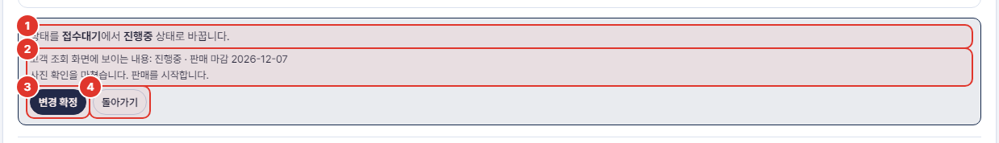

| 번호 | 이름 | 하는 일 |
| :---: | --- | --- |
| **1** | 바꾸는 내용 | 어떤 상태에서 어떤 상태로 바꾸는지 보여 줍니다. 처리완료나 취소·반려처럼 **되돌릴 수 없는 상태**면 그 사실도 알려 줍니다. |
| **2** | 고객에게 보이는 내용 | 저장하면 고객의 진행 조회 화면에 나올 상태, 날짜, 안내문입니다. |
| **3** | 변경 확정 | 누르면 저장됩니다. |
| **4** | 돌아가기 | 저장하지 않고 다시 고칩니다. |

확인 줄이 떠 있을 때 칸의 값을 바꾸면 확인 줄이 닫힙니다. 다시 **변경사항 저장**을 눌러 바뀐 내용으로 확인하세요.

---

## 6. 문자 문구

가구 칸 맨 아래의 **문자 문구**를 누르면 펼쳐집니다. 고객에게 보낼 문자를 접수 정보로 미리 채워 줍니다.

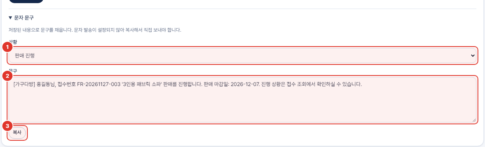

| 번호 | 이름 | 하는 일 |
| :---: | --- | --- |
| **1** | 상황 | **접수 확인 / 판매 진행 / 반출 일정 확정 / 처리 완료 / 취소** 중에서 고릅니다. 처음에는 지금 상태에 맞는 상황이 골라져 있습니다. |
| **2** | 문구 | 고객 이름, 접수번호, 가구 이름, 날짜가 채워진 문구입니다. 직접 고칠 수 있습니다. 아직 정하지 않은 날짜는 `[반출 일정]`처럼 대괄호로 남으니 채워서 보내세요. |
| **3** | 복사 | 문구를 복사합니다. 휴대폰의 문자 앱에 붙여 넣어 보냅니다. |

문구는 **저장된 내용**으로 채워집니다. 날짜를 방금 고쳤다면 먼저 저장한 뒤에 문구를 여세요.

> [!NOTE]
> 문자 발송 서비스(솔라피)를 연결해 두면 3번 옆에 **문자 보내기**가 생깁니다. 누르면 신청자 번호로 바로 문자가 나가고, 보낸 기록이 변경 이력에 남습니다. 연결하지 않았다면 복사해서 직접 보내면 됩니다.

---

## 7. 사진 크게 보기와 변경 이력

가구 칸의 사진을 누르면 큰 창으로 열립니다. 접수 목록의 작은 사진을 눌러도 같은 창이 열리고, 그때는 그 접수의 모든 가구 사진을 차례로 넘겨 봅니다.

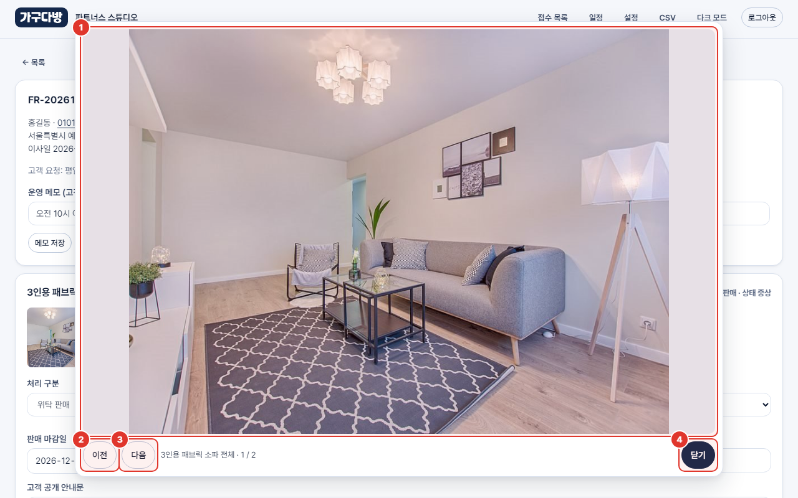

| 번호 | 이름 | 하는 일 |
| :---: | --- | --- |
| **1** | 큰 사진 | 흠집이나 얼룩을 자세히 봅니다. |
| **2** | 이전 | 앞 사진으로 갑니다. 키보드의 ← 키도 됩니다. 사진 아래에 가구 이름과 `2 / 5`처럼 몇 번째 사진인지 나옵니다. |
| **3** | 다음 | 다음 사진으로 갑니다. 키보드의 → 키도 됩니다. |
| **4** | 닫기 | 창을 닫습니다. `Esc` 키나 창 바깥을 눌러도 닫힙니다. |

사진이 한 장뿐이면 이전·다음은 나오지 않습니다.

### 변경 이력

화면 맨 아래에는 이 접수에서 일어난 일이 시간순으로 남습니다. 지우거나 고칠 수 없습니다.

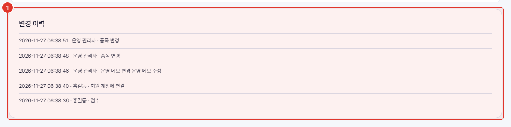

| 번호 | 이름 | 하는 일 |
| :---: | --- | --- |
| **1** | 변경 이력 | **언제, 누가, 무엇을** 했는지 보여 줍니다. 접수, 품목 변경, 운영 메모 변경, 고객 취소, 회원 계정에 연결, 문자 발송이 기록됩니다. 최근 일이 위에 있습니다. |

---

## 8. 일정 보기

위쪽의 **일정**을 누르면 달력이 나옵니다. 이사일, 판매 마감일, 확정된 반출 일정을 날짜별로 봅니다.

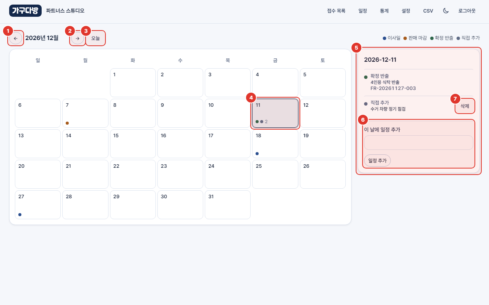

| 번호 | 이름 | 하는 일 |
| :---: | --- | --- |
| **1** | 이전 달 | 앞 달로 갑니다. |
| **2** | 다음 달 | 다음 달로 갑니다. |
| **3** | 오늘 | 오늘 날짜로 돌아옵니다. |
| **4** | 날짜 칸 | 일정이 있는 날에는 색 점이 찍힙니다. 날짜를 누르면 오른쪽에 그날 일정이 나옵니다. |
| **5** | 그날 일정 | 일정의 종류와 접수번호가 보입니다. 이름을 누르면 그 접수가 열립니다. |
| **6** | 이 날에 일정 추가 | 접수와 상관없는 일정(휴무, 차량 점검 등)을 직접 넣습니다. 날짜를 먼저 누르고, 이름을 쓴 뒤 **일정 추가**를 누릅니다. |
| **7** | 점 색 | 달력에 찍힐 점의 색을 고릅니다. 첫 번째 회색이 기본이고, **마지막 칸을 누르면 아무 색이나** 고를 수 있습니다. |
| **8** | 삭제 | 직접 넣은 일정을 지웁니다. 누르면 **정말 지울지 묻는 창**이 뜨고, **삭제**를 눌러야 지워집니다. 접수에서 나온 일정(이사일, 판매 마감, 확정 반출)은 여기서 지울 수 없고, 접수에서 날짜를 고쳐야 합니다. |

점의 색은 오른쪽 위에 풀이가 있습니다: **이사일 / 판매 마감 / 확정 반출 / 직접 추가**(직접 추가한 일정은 고른 색으로 찍힙니다). 끝난 가구(처리완료, 취소·반려)의 일정은 달력에 나오지 않습니다.

---

## 9. 통계 보기

위쪽의 **통계**를 누릅니다. 고른 기간의 방문과 접수를 차트로 봅니다. 위에서 아래로 중요한 순서입니다.

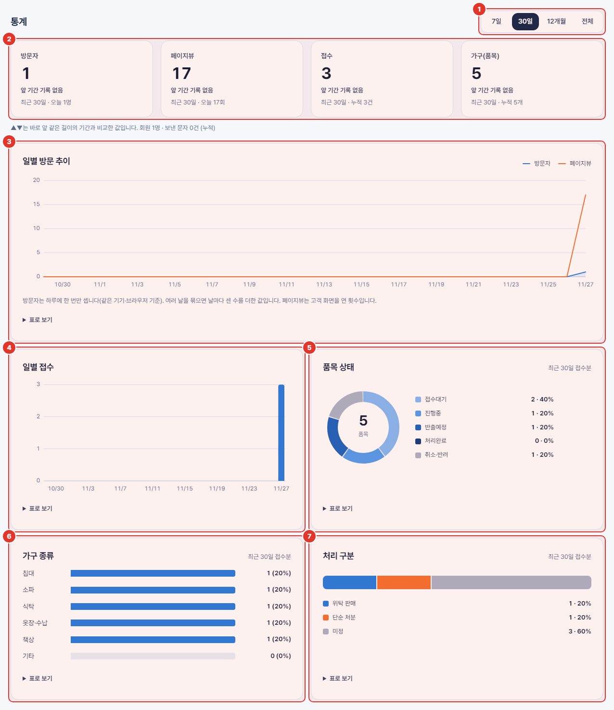

| 번호 | 이름 | 하는 일 |
| :---: | --- | --- |
| **1** | 기간과 CSV | **7일·30일**은 날짜별, **12개월**은 달별, **전체**는 연도별로 묶어 보여 줍니다. 처음에는 30일입니다. 왼쪽의 **접수 목록 CSV 내려받기**는 지금까지의 모든 접수를 엑셀에서 열 수 있는 파일로 내려받습니다(기간과 상관없이 전체). |
| **2** | 핵심 숫자 | 고른 기간의 방문자, 페이지뷰, 접수, 가구(품목) 수입니다. ▲▼는 바로 앞 같은 길이의 기간과 비교한 변화이고, 아래 줄에 오늘 방문자와 누적 수가 있습니다. |
| **3** | 방문 추이 | 방문자(파란 선)와 페이지뷰(주황 선)입니다. 차트 위에 마우스를 올리거나, 차트를 Tab으로 고른 뒤 방향키를 누르면 그날 값이 뜹니다. |
| **4** | 접수 | 기간 안에 들어온 접수 건수 막대입니다. |
| **5** | 품목 상태 | 기간 안에 접수된 가구가 지금 어느 단계에 있는지와 비율입니다. |
| **6** | 가구 종류 | 침대, 소파, 식탁 등 종류별 수를 많은 순서로 보여 줍니다. |
| **7** | 처리 구분 | 위탁 판매, 단순 처분, 미정의 비율입니다. |

> 차트마다 아래의 **표로 보기**를 누르면 같은 값을 표로 볼 수 있습니다.
>
> **방문자**는 고객 화면을 연 사람을 하루에 한 번만 셉니다(같은 기기·브라우저 기준). 여러 날을 묶으면 날마다 센 수를 더한 값입니다. **페이지뷰**는 고객 화면을 연 횟수입니다. 관리자 화면을 연 것은 세지 않습니다. 접속 기록에는 IP 주소와 브라우저 정보를 그대로 남기지 않고, 그날만 쓰는 값과 섞어 되돌릴 수 없게 바꾼 값만 남깁니다.

---

## 10. 설정

위쪽의 **설정**을 누릅니다.

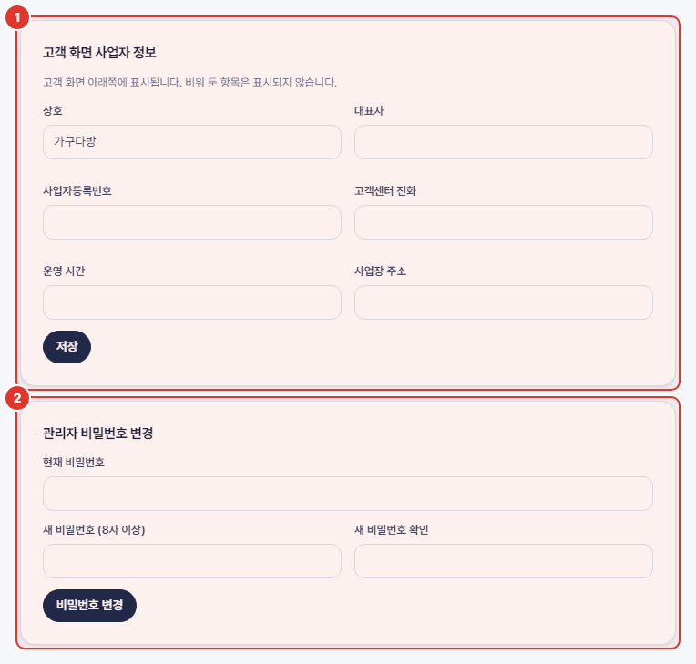

| 번호 | 이름 | 하는 일 |
| :---: | --- | --- |
| **1** | 고객 화면 사업자 정보 | 상호, 대표자, 사업자등록번호, 고객센터 전화, 운영 시간, 사업장 주소를 넣습니다. **고객 화면 맨 아래에 표시**되고, 비워 둔 항목은 표시되지 않습니다. |
| **2** | 관리자 비밀번호 변경 | 현재 비밀번호를 쓰고 새 비밀번호(8자 이상)를 두 번 씁니다. |

> [!IMPORTANT]
> 고객 가이드와 화면 여러 곳에서 "고객센터로 문의해 주세요"라고 안내합니다. **고객센터 전화와 운영 시간을 꼭 넣어 두세요.**

---

## 11. 휴대폰에서 쓰기

휴대폰에서도 같은 주소로 들어가면 됩니다. 메뉴가 화면 **아래쪽 탭**으로 바뀝니다.

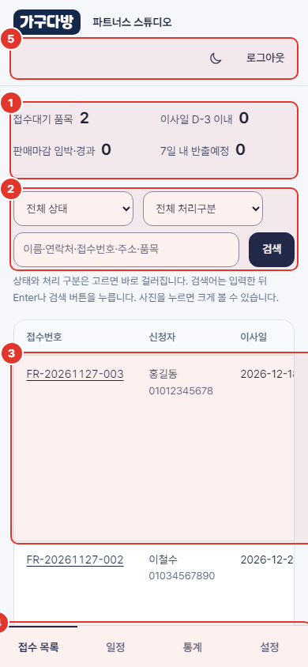

| 번호 | 이름 | 하는 일 |
| :---: | --- | --- |
| **1** | 오늘 확인할 숫자 | 컴퓨터 화면과 같은 네 가지 숫자입니다. |
| **2** | 찾기 | 상태, 처리 구분(고르면 바로 적용), 검색어로 접수를 찾습니다. |
| **3** | 접수 한 줄 | 접수번호를 누르면 열립니다. |
| **4** | 아래 탭 | **접수 목록 / 일정 / 통계 / 설정**으로 이동합니다. |
| **5** | 도구 | 로고 아래 줄 오른쪽에 **달 모양 버튼(어두운 화면), 로그아웃**이 모여 있습니다. CSV는 통계 화면에 있습니다. |

접수를 열면 칸이 한 줄에 하나씩 세로로 놓입니다.

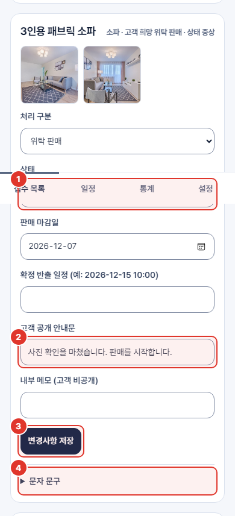

| 번호 | 이름 | 하는 일 |
| :---: | --- | --- |
| **1** | 상태 | 바꿀 상태를 고릅니다. |
| **2** | 고객 공개 안내문 | 고객에게 보일 글을 씁니다. |
| **3** | 변경사항 저장 | 누르면 확인 줄이 나오고, 확정하면 저장됩니다. |
| **4** | 문자 문구 | 펼쳐서 문구를 복사한 뒤 문자 앱에 붙여 넣습니다. |

---

## 12. 용어 풀이

| 말 | 뜻 |
| --- | --- |
| **접수** | 고객이 한 번에 낸 신청 한 건. 가구가 1~20개 들어 있습니다. |
| **품목** | 접수 안의 가구 하나. 상태와 일정은 품목마다 따로 있습니다. |
| **처리 구분** | 운영자가 정하는 처리 방식(위탁 판매, 단순 처분). 고객이 원한 방식은 "희망 처리"입니다. |
| **판매 마감일** | 위탁 판매를 언제까지 할지 정한 날. 이사일을 넘길 수 없습니다. |
| **확정 반출 일정** | 방문해서 가구를 가져가기로 확정한 날짜와 시간. |
| **고객 공개 안내문** | 고객의 진행 조회 화면에 보이는 글. |
| **운영 메모 · 내부 메모** | 운영자만 보는 글. 고객 화면에는 나오지 않습니다. |
| **D-숫자** | 그날까지 남은 날 수. `D-3`은 3일 남았다는 뜻이고, `D+2`는 2일 지났다는 뜻입니다. |
| **PIN** | 고객이 접수할 때 정한 숫자 4자리. 운영자도 알 수 없습니다. |

---

## 자주 겪는 일

**상태를 반출예정으로 바꾸려는데 저장이 안 돼요.**
**확정 반출 일정** 칸이 비어 있으면 저장되지 않습니다. 날짜와 시간을 먼저 쓰세요.

**취소·반려로 바꾸려는데 저장이 안 돼요.**
**고객 공개 안내문**에 이유를 써야 합니다. 고객이 조회 화면에서 이유를 볼 수 있어야 하기 때문입니다.

**판매 마감일이 저장되지 않아요.**
이사일보다 뒤의 날짜는 넣을 수 없습니다. 접수 위쪽의 이사일을 확인하세요.

**상태를 잘못 바꿨어요.**
진행중과 반출예정은 서로 오갈 수 있습니다. **처리완료**와 **취소·반려**는 되돌릴 수 없으니 확인 줄을 꼭 읽고 확정하세요.

**고객이 PIN을 잊었다고 해요.**
PIN은 다시 볼 수 없게 저장됩니다. 접수번호와 연락처로 본인을 확인한 뒤, 진행 상황을 직접 안내해 주세요.

**고객이 처리가 시작된 뒤에 취소를 원해요.**
고객 화면에서는 접수대기일 때만 취소할 수 있습니다. 운영자가 그 가구의 상태를 **취소·반려**로 바꾸고 안내문에 이유를 남기세요.

**접수 내역이 갑자기 비어 보여요.**
시연용 Vercel 주소(`gagudabang.vercel.app`)는 서버가 새로 시작되면 접수 데이터와 사진이 지워지고 예시 접수만 다시 들어갑니다. 실제 접수는 데이터가 보존되는 운영 서버 주소에서 받으세요. 자세한 내용은 [개발 진행 현황](../DEVELOPMENT_STATUS.md)에 있습니다.
