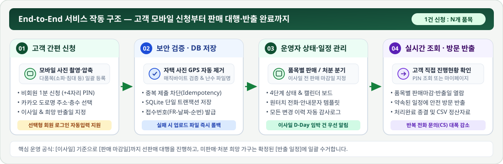
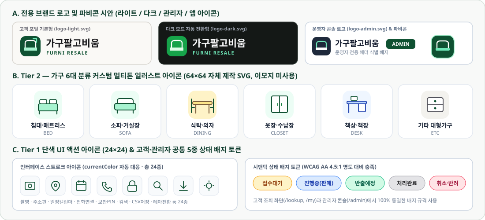
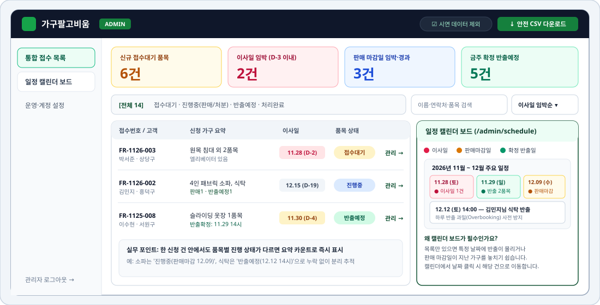
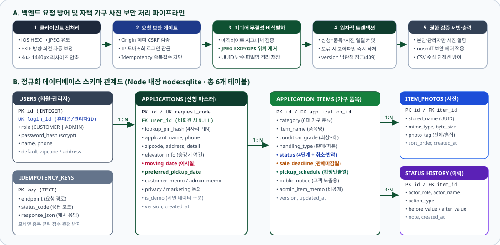

# 가구팔고비움 (`furni-resale`) 종합 서비스 설계 및 구현 기획서

- **문서 기준일**: 2026-11-26 · **버전**: v2.0 (시각 다이어그램·화면 목업 통합본)
- **상태**: 설계 확정 대기 (구현 전 상세 기획서)
- **열람용 PDF**: [서비스_종합_설계기획서.pdf](서비스_종합_설계기획서.pdf) · **벤치마킹 리포트**: [국내_중고가구_플랫폼_벤치마킹_분석서.pdf](국내_플랫폼_분석/국내_중고가구_플랫폼_벤치마킹_분석서.pdf)

본 문서는 견적서 과업 범위와 국내 7대 유사 플랫폼 분석에서 도출한 공통 필수 기능, 그리고 상용 웹 플랫폼이 기본적으로 갖춰야 할 **브랜드 로고·커스텀 SVG 아이콘·인증(로그인/비회원 조회)·프론트엔드 화면 설계·백엔드 보안 및 운영 백오피스**를 시각 도식과 함께 정리한 기준 문서입니다.

---

## 1. 기획 범위 및 보강 내역 요약

| 영역 | 초기 간이 설계 | 보강된 종합 설계 (상용 플랫폼 필수 기준 반영) |
| --- | --- | --- |
| **브랜드 · 그래픽** | 텍스트 타이틀 위주 | 전용 워드마크·심볼 SVG 로고(라이트/다크/관리자용), 파비콘, 카톡/문자 공유용 OG 이미지, **무(無)이모지 2단계 커스텀 SVG 아이콘 체계**(UI 스트로크 24종 + 가구·절차 일러스트 9종) |
| **인증 · 로그인** | 관리자 로그인만 존재 | **듀얼 포털 쿠키 분리(`fr_customer` / `fr_admin`)** + 비회원 1분 신청 & **4자리 PIN 간편 조회(`/lookup`)** + **고객 간편 회원가입·로그인(`/login`, `/signup`, `/my`)** + 관리자 로그인 5회 실패 잠금·비밀번호 변경 |
| **프론트 · UI/UX** | 소개 + 단순 입력 폼 | 상단 GNB/모바일 드로어, **카카오(Daum) 무료 도로명 주소 검색(+수동 폴백)**, **모바일 사진 리사이즈·EXIF 회전 보정**, 작성 중 `sessionStorage` 임시저장, 판매/처분 기준 가이드·FAQ, 법정 분리 동의 체크, 사업자·이용약관·개인정보처리방침 표준 푸터, 라이트/다크 테마(WCAG AA 4.5:1) |
| **관리자 백오피스** | 단순 목록 + 상태 변경 | 실시간 KPI 요약 카드, **이사일·판매마감일·반출일 월간/주간 캘린더 보드(`/admin/schedule`)**, 원터치 전화·안내 문자(`sms:`) 템플릿 연동, 시연 데이터 숨김 토글, **UTF-8 BOM 안전 CSV 다운로드**, 변경 이력 타임라인 |
| **백엔드 · 보안** | 기본 CRUD + 파일 저장 | `scrypt` 솔트 해싱, `Origin` CSRF 검증, `Idempotency-Key` 중복 접수 차단, 낙관적 잠금(`version` → `409`), **이미지 매직바이트 검사 + 자택 사진 EXIF/GPS 위치정보 자동 제거**, 권한 검증 이미지 서빙, `status_history` 감사 로그 |

---

## 2. 브랜드 아이덴티티 · 로고 · 커스텀 SVG 아이콘 규격

### 2.1 브랜드 로고 (`public/assets/brand/`)
기획 초기의 임시 로고 시안(심볼 + `가구팔고비움`)은 쓰지 않는다. 지금 로고는 아래 두 파일이다.
1. **가로형 글자 로고 (`logo.svg`)**
   - "가구다방" 글자 로고. 남색(`#14284B`) 바탕에 흰 글자이고, 밝은 화면과 어두운 화면에서 같은 파일을 쓴다. 고객 화면과 관리자 화면의 머리글에 들어간다.
2. **정사각 아이콘 (`icon.svg`)**
   - 같은 글자 로고를 정사각 바탕에 올린 것. 브라우저 탭 아이콘과 앱(PWA) 아이콘으로 쓴다.
3. 공유용 대표 이미지(`og-image`)는 아직 만들지 않았다.

### 2.2 디자인 토큰 및 접근성 기준 (`src/styles/tokens.css`)
- **컬러 시스템**: 웜 오프화이트(`#FAF9F6`) 배경 + 퓨어 화이트(`#FFFFFF`) 카드 + 딥 에메랄드 그린(`#0F5132`) 브랜드 포인트 + `[data-theme="dark"]` 다크모드 지원 (전 조합 WCAG AA `4.5:1` 명도 대비 준수)
- **통합 상태 배지(Status Chip) 5종**: `접수대기(PENDING)` · `진행중(IN_PROGRESS)` · `반출예정(SCHEDULED)` · `처리완료(COMPLETED)` · `취소·반려(CANCELED)`를 고객·관리자 전 화면에서 동일하게 사용

---

## 3. 고객 포털 화면 설계 (모바일 퍼스트 UI/UX)

### 3.1 메인 랜딩(`/`) 및 다품목 가구 신청 폼(`/apply`) 화면 목업

- **메인 랜딩 (`/`)**: 히어로 배너, 3단계 이용절차 타임라인, **판매 대행 가능 품목 vs 단순 처분(비움) 품목 기준 안내표**, FAQ 아코디언, 사업자·이용약관·개인정보처리방침 표준 푸터, 모바일 하단 고정 `무료 신청하기` Sticky CTA 바
- **다품목 가구 신청 폼 (`/apply`)**:
  - **카카오(Daum) 무료 우편번호 도로명 주소 검색** 연동 (외부망 차단 시 수동 입력 자동 폴백) + 층수·엘리베이터 유무 선택
  - `이사일` · `희망 반출일` 캘린더 선후 검증 및 촉박 일정 안내
  - **다품목 가구 카드 동적 추가(`1~10개`)**: 6대 분류 아이콘, 품목명, 상태 4등급(`최상/상/중/하-처분희망`), 촬영 가이드 다중 사진 업로드(클라이언트 리사이즈·EXIF 회전 보정·썸네일 미리보기)
  - 비회원 **조회용 숫자 4자리 PIN** 설정 + 법정 `[필수] 수집·이용 동의` / `[선택] 안내 알림 동의` 분리 체크 + `sessionStorage` 자동 임시저장

### 3.2 비회원 진행 조회(`/lookup`) · 간편 로그인(`/login`) · 듀얼 세션 분리

| 역할 구분 | 인증 수단 | 허용 권한 및 데이터 노출 범위 |
| --- | --- | --- |
| **일반 방문자** | 무인증 | 랜딩(`/`), 이용약관(`/terms`), 개인정보처리방침(`/privacy`) 열람 및 신규 신청서(`/apply`) 제출 |
| **비회원 조회자** | 연락처(또는 접수번호) + 4자리 PIN | 본인 신청 건의 가구 목록, 품목별 4단계 상태, 판매 마감일, 확정 반출일, `public_notice` 열람 및 `접수대기` 단계 취소 |
| **로그인 회원** | `fr_customer` 서명 세션 쿠키 | 신청 폼 기본정보·주소 1초 자동입력, 내 전체 신청 이력(`/my`) 통합 조회, 기존 비회원 신청 건 계정 연결 |
| **운영 관리자** | `fr_admin` 서명 세션 쿠키 (별도 격리) | 전체 접수 조회·필터, 품목별 상태·마감일·반출일·비공개 내부메모(`admin_memo`) 관리, 캘린더 보드, 안전 CSV 다운로드 |

---

## 4. 운영자(관리자) 콘솔 화면 설계 (`noindex, nofollow`)

### 4.1 통합 접수 대시보드(`/admin`) 및 일정 캘린더 보드(`/admin/schedule`)

- **통합 접수 대시보드 (`/admin`)**: 상단 4대 실시간 KPI 카드(`신규 접수대기`, `이사일 D-3 임박`, `판매마감 임박·경과`, `금주 반출예정`), 상태·구분 필터, 통합 키워드 검색, 정렬(`이사일 임박순` 기본), 시연 데이터 제외 토글, 수식 인젝션 방어 UTF-8 BOM CSV 다운로드
- **일정 캘린더 보드 (`/admin/schedule`)**: 월간/주간 캘린더 위에 **이사일(적색) · 판매 마감일(황색) · 확정 반출일(녹색)**을 시각화하여 특정 일자 수거 과밀(Overbooking) 및 마감일 누락을 예방

### 4.2 접수 상세 및 품목별 상태·일정 처리 콘솔(`/admin/applications/[id]`)

- **원터치 고객 소통**: `tel:` 즉시 통화 연결 및 상황별 **안내 문자(`sms:`) 템플릿 자동 완성** 버튼 제공
- **품목별 정밀 제어**: 고화질 사진 확대 라이트박스, 처리 구분(`판매대행/단순처분`), 4단계 상태(`접수대기 → 진행중 → 반출예정 → 처리완료` 및 예외 `취소·반려`), `판매 마감일`, `확정 반출 일정`, **고객 공개 안내문(`public_notice`)과 관리자 비공개 메모(`admin_item_memo`) 분리 저장**
- **감사 이력 로그 (`STATUS_HISTORY`)**: 누가·언제·무엇을 변경했는지 하단 타임라인에 자동 누적 기록

---

## 5. 백엔드 보안 파이프라인 · 데이터베이스(ERD) · API 설계

### 5.1 핵심 백엔드 API 계약 요약

| 구분 | 메서드 · 경로 | 권한 | 주요 처리 및 보호 규칙 |
| --- | --- | --- | --- |
| **신청** | `POST /api/applications` | 공개 | `Idempotency-Key` 중복 방지, 매직바이트 검사·JPEG EXIF GPS 제거, SQLite 단일 트랜잭션 생성 |
| **조회/취소** | `POST /api/applications/lookup` · `cancel` | 본인(PIN/회원) | 관리자 비공개 메모 제외 DTO 반환, 전 품목 `PENDING` 시에만 고객 취소 허용 |
| **회원** | `POST /api/auth/signup` · `login` · `logout` | 공개 / 회원 | `scrypt` 해싱, `fr_customer` 쿠키 발급, 마이페이지(`/api/my/*`) 기본 주소·신청 이력 연동 |
| **미디어** | `GET /api/uploads/[storedName]` | 관리자 / 본인 | 열람 권한 검증 후 `X-Content-Type-Options: nosniff` 적용 서빙 (타인 추측 접근 시 `404`) |
| **관리자** | `GET / PATCH /api/admin/*` | 관리자 (`fr_admin`) | 5회 로그인 실패 60초 잠금, KPI·목록·캘린더 조회, 품목 수정 시 `version` 낙관적 잠금(`409`) 및 `STATUS_HISTORY` 기록, 안전 CSV 출력 |

---

## 6. 분야별 구현 작업 매트릭스 및 단계별 로드맵

| 단계 | 코드 | 담당 영역 | 핵심 구현 산출물 및 검증 기준 |
| --- | :---: | --- | --- |
| **Phase 1** | `UI01` · `UI02` | 무충돌 기반·로고·SVG | 순수 `HTML/CSS/TS` + `Express(TS)` 분리형 `tsconfig` 세팅, `tokens.css`, 로고 SVG 3종·파비콘·PWA 매니페스트, `UiIcon` 24종 + `DomainArtwork` 9종 |
| **Phase 2** | `DB01` · `BE01~02` | DB·인증·미디어 보안 | `node:sqlite` 6개 테이블 멱등 스키마·시드, `scrypt`·듀얼 세션 쿠키·5회 잠금·CSRF, 매직바이트 검증 및 EXIF GPS 제거 스토리지 |
| **Phase 3** | `BE03` · `BE04` | 고객·관리자 API | 다품목 신청·비회원 PIN 조회·회원 연동·권한 이미지 서빙 API, 관리자 목록·KPI·캘린더·품목 처리(`409`+감사로그)·안전 CSV API |
| **Phase 4** | `UI03` · `UI04` · `UI05` | 고객 포털 화면 | `/` 랜딩·취급안내·FAQ·표준 푸터·약관, `/apply` 카카오 주소검색·사진압축·임시저장 신청 폼, `/lookup` 조회 및 `/login`·`/my` 화면 |
| **Phase 5** | `UI06` | 관리자 백오피스 | `/admin/login`, `/admin` 통합 대시보드, `/admin/schedule` 일정 캘린더 보드, `/admin/applications/[id]` 상세 처리 및 `/admin/settings` |
| **Phase 6** | `QA01` | 자동화 검증·납품 | `node:test` 백엔드·보안·명도 대비 테스트, `npm run build` 정적 검증, 모바일(`390px`)·데스크톱(`1280px`) E2E 점검 및 납품용 `README.md` 완성 |
