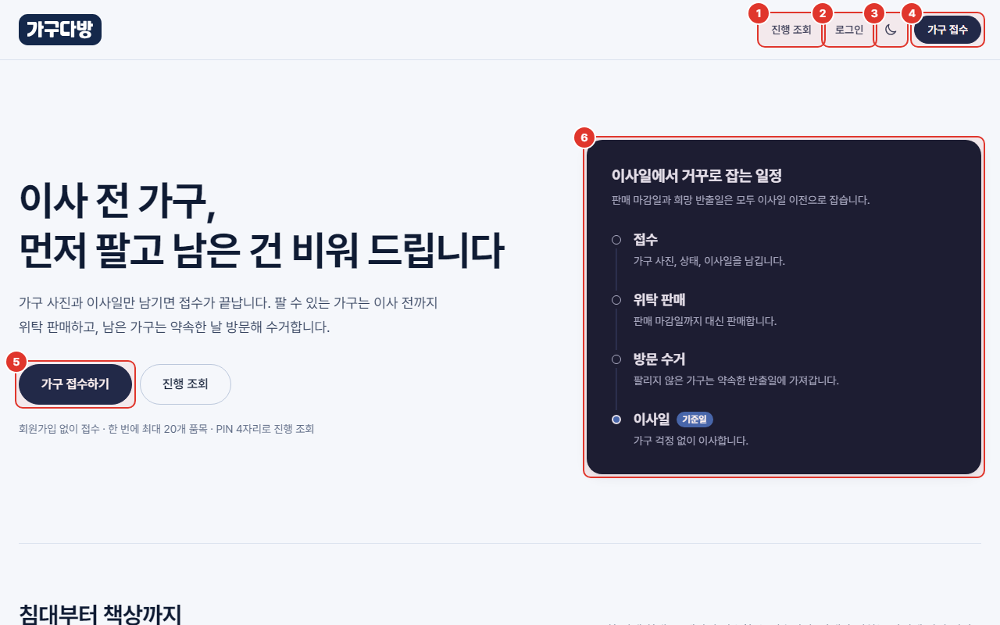
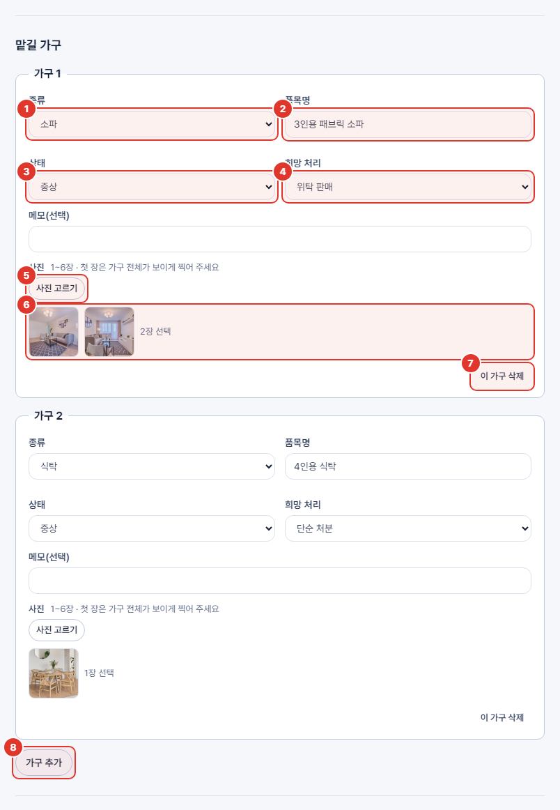
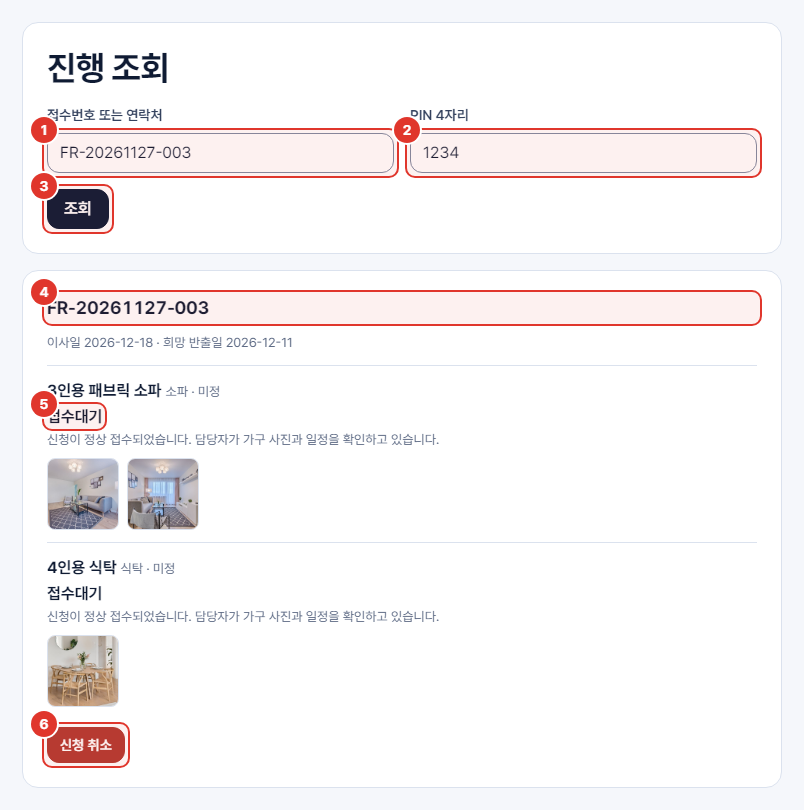
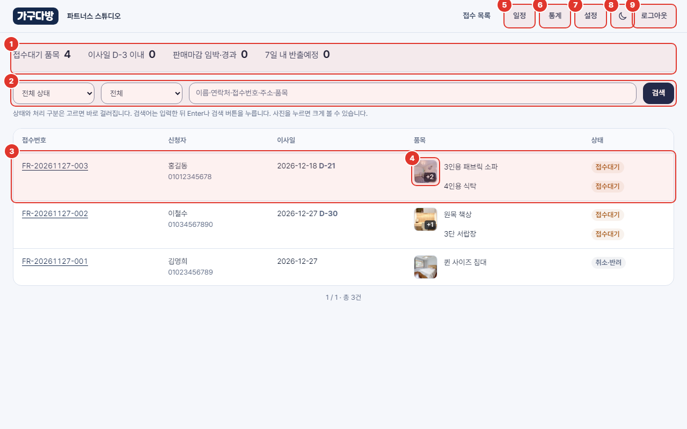
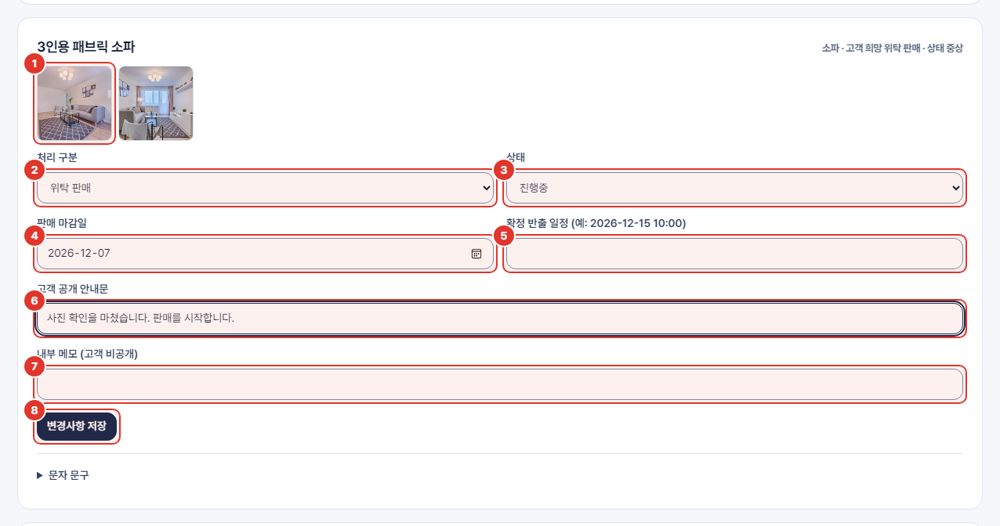
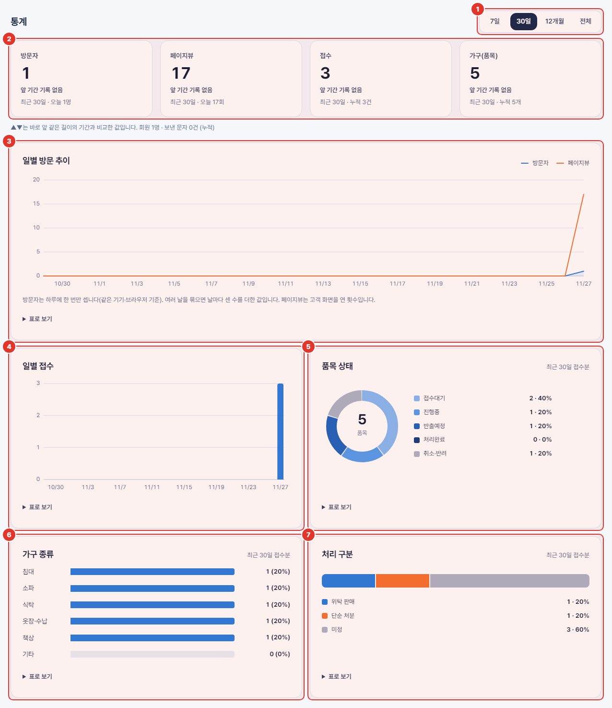

# 가구다방 서비스 종합 설계기획서

- **문서 기준일**: 2026-11-27 · **버전**: v3.0 (구현 반영판)
- **상태**: 구현 완료, 시연 배포 중. 실제 휴대폰 점검과 운영 전 정리가 남았다.
- **열람용 PDF**: [서비스_종합_설계기획서.pdf](서비스_종합_설계기획서.pdf) · **기술 명세**: [기술_상세_기획서.md](기술_상세_기획서.md) · **벤치마킹**: [국내 중고가구 플랫폼 분석서](국내_플랫폼_분석/국내_중고가구_플랫폼_벤치마킹_분석서.md)

이사 전 가구를 맡기면 이사일 전까지 대신 팔고, 팔리지 않은 가구는 약속한 날 방문해 수거하는 서비스다. 고객은 사진과 이사일만 남겨 접수하고, 운영자는 가구마다 처리 방식·상태·판매 마감일·반출 일정을 정한다. 이 문서는 처음 기획(v2.0, 2026-11-26)을 실제로 만든 결과에 맞춰 고친 것이고, 화면 그림은 모두 실제 앱을 찍은 것이다.

---

## 1. 한눈에 보기

| 항목 | 내용 |
| --- | --- |
| 서비스 이름 | 가구다방 (`GaguDabang`). 기획 단계의 가칭 "가구팔고비움"은 쓰지 않는다 |
| 사용자 | 고객(회원·비회원), 운영자(관리자 1명 이상) |
| 화면 | 고객 화면 `/`, 관리자 화면 `/admin` (두 화면 모두 휴대폰·컴퓨터 겸용, 밝은·어두운 테마) |
| 기술 | Node.js, Express 4, TypeScript, 내장 SQLite(`node:sqlite`), 번들러 없는 바닐라 TS 화면 |
| 배포 | Vercel `https://gagudabang.vercel.app` (시연용, 데이터가 보존되지 않음), 개인 서버 `https://gagudabang.mib.dpdns.org` (데이터 보존) |
| 품질 | 자동 테스트 59개, 세 브라우저 엔진(Edge·Firefox·WebKit) 화면 점검, 이용 가이드 26단계 자동 촬영 점검 |

### 견적 범위와 구현 결과

| 견적 품목 | 구현 결과 |
| --- | --- |
| 서비스 소개·이용 절차 페이지 | 첫 화면에 소개, 4단계 일정, 가구 종류, 처리 방식, 자주 묻는 질문, 접수 버튼 |
| 가구 신청 및 사진 첨부 | 가구 1~20개, 가구마다 사진 1~6장(휴대폰 카메라·사진첩), 연락처·품목·상태·이사일·희망 반출일 필수 |
| 관리자 접수·상태·일정 관리 | 로그인, 접수 목록·상세, 품목별 상태·판매 마감일·반출 일정, 일정 달력, 통계, 설정 |
| 모바일 점검 및 소스 전달 | 휴대폰 크기 화면 자동 점검과 GitHub 저장소. 실제 기기 점검은 남음 |

요구 항목별 대조표는 [개발 진행 현황](DEVELOPMENT_STATUS.md)의 "견적 요구사항 대조"에 있다.

---

## 2. 처음 기획에서 바뀐 점

| 영역 | 처음 기획 (v2.0) | 지금 구현 |
| --- | --- | --- |
| 브랜드 | 가칭 "가구팔고비움", 심볼 + 글자 로고 3종 | "가구다방" 글자 로고 한 가지(남색 바탕, 흰 글자)와 정사각 아이콘 |
| 색과 글꼴 | 웜 오프화이트 + 딥 그린 | 남색(`#14284b`) + 흰색, Pretendard 한 가지. 토큰은 `public/styles/tokens.css` 한 곳 |
| 화면 주소 | `/apply`, `/lookup`, `/admin/schedule` 같은 경로 | 한 페이지 안의 해시 주소: 고객 `/#apply`, `/#lookup`, `/#my`, 관리자 `/admin#dashboard`, `#schedule`, `#stats`, `#settings` |
| 가구 수 | 1~10개 | 1~20개 |
| 신청서 임시저장 | `sessionStorage` 자동 저장 | 만들지 않음 |
| 안내 문자 | `sms:` 링크로 문자 앱 열기 | 상황별 문구 5종을 채워 복사. 솔라피를 연결하면 "문자 보내기"로 바로 발송하고 기록 |
| 시연 데이터 | 관리자 화면의 "시연 데이터 숨김" 토글 | 예시 데이터(`is_demo = 1`)를 서버가 처음 한 번 넣고, `npm run demo:clear`로 지운다 |
| 관리자 화면 | 대시보드, 일정, 상세, 설정 | 위에 더해 통계(방문자·페이지뷰·접수·품목, 기간 선택, 차트 5종), 직접 추가 일정(점 색 선택) |
| 확인 창 | 브라우저 기본 창 | 화면과 같은 디자인의 확인 창(일정 삭제, 문자 보내기, 고객 신청 취소) |

---

## 3. 브랜드와 디자인 기준

- **로고**: `public/assets/brand/logo.svg`(가로형 글자 로고)와 `icon.svg`(정사각, 탭·앱 아이콘). 관리자 화면의 로고는 누르면 관리자 홈(접수 목록)으로 간다.
- **링크 공유 그림**: 고객용 `og-image.jpg`(로고, 한 줄 소개, 소파를 옮기는 사진), 관리자용 `og-admin.jpg`(로고, "관리자 페이지", 가구 카드 세 장). 개인 서버는 공유 정보의 주소를 들어온 주소로 바꿔 내보낸다.
- **색**: 남색과 흰색이 바탕이고, 의미 색은 상태에만 쓴다. 어두운 테마는 같은 토큰을 따로 정의했고, 사용자가 고른 테마만 기기에 기억한다.
- **상태 5가지와 뱃지 색**: 접수대기(주황), 진행중(파랑), 반출예정(남색), 처리완료(초록), 취소·반려(회색). 글자로도 상태를 적어 색만으로 구분하지 않는다. 밝은 화면의 최저 글자 대비는 4.57:1이다.
- **부품 규칙**은 [디자인 시스템](DESIGN_SYSTEM.md)에 있다(버튼, 입력, 표, 상태 뱃지, 확인 창, 아이콘 버튼, 차트 색).

---

## 4. 고객 화면

- **첫 화면 (`/#home`)**: 소개 문장, "이사일에서 거꾸로 잡는 일정" 4단계(접수 → 위탁 판매 → 방문 수거 → 이사일), 맡길 수 있는 가구 6종류, 처리 방식 3가지(위탁 판매, 단순 처분, 상담 후 결정), 자주 묻는 질문. 위쪽 "+ 가구 접수"와 본문 "가구 접수하기"로 신청 화면에 들어간다.
- **가구 접수 (`/#apply`)**: 이름, 휴대폰 번호, 조회용 PIN 4자리, 주소(다음 우편번호 검색 또는 직접 입력), 엘리베이터, 이사일, 희망 반출일(이사일 이전), 가구별 종류·품목명·상태·희망 처리·사진. 사진은 올리기 전에 회전을 바로잡고 줄이며, 서버가 파일 형식을 확인하고 위치 정보를 지운다. 같은 접수가 두 번 들어가지 않게 막는다.

- **접수 완료**: 접수번호(`FR-날짜-순번`)를 보여 주고 진행 조회로 이어 준다.
- **진행 조회 (`/#lookup`)**: 접수번호 또는 휴대폰 번호와 PIN으로 본인 접수를 본다. 가구마다 상태, 판매 마감일, 반출 일정, 담당자 안내문이 나온다. 모든 가구가 접수대기일 때만 고객이 직접 취소할 수 있다. PIN을 5번 틀리면 1분 동안 막힌다.

- **회원 (`/#signup`, `/#login`, `/#my`)**: 가입은 선택이다. 로그인하면 이름과 기본 주소가 신청서에 자동으로 채워지고, 마이페이지에서 내 접수를 PIN 없이 모아 보며, 가입 전에 낸 접수를 접수번호와 PIN으로 연결한다.
- **약관 (`/#terms`, `/#privacy`)**: 이용약관과 개인정보 처리방침. 방문 기록을 자동으로 모은다는 내용이 들어 있다. 법률 검토는 남았다.

---

## 5. 관리자 화면

- **로그인**: 화면 정가운데의 로그인 창. 5번 틀리면 1분 잠금, 로그인은 12시간 유지된다.
- **접수 목록 (`/admin#dashboard`)**: 오늘 확인할 숫자 4가지(접수대기 품목, 이사일 D-3 이내, 판매마감 임박·경과, 7일 내 반출예정), 상태·처리 구분(고르면 바로 적용)과 검색어로 찾기, 이사일이 가까운 순서. 접수마다 첫 사진 한 장과 `+N`, 품목 이름, 품목마다의 상태 뱃지가 한 줄에 놓인다. 사진을 누르면 그 접수의 모든 사진을 `<` `>`로 넘겨 본다.
- **접수 상세**: 신청 정보(연락처를 누르면 전화), 고객 요청, 운영 메모. 가구마다 처리 구분, 상태(정해진 순서로만 변경), 판매 마감일(이사일 이전), 확정 반출 일정, 고객 공개 안내문, 내부 메모를 정하고 저장한다. 상태를 바꿀 때는 고객에게 보일 내용을 먼저 보여 주고 확정받는다. 다른 운영자가 먼저 고쳤으면 저장을 막고 최신 내용을 다시 불러온다. 맨 아래에 변경 이력이 쌓인다.

- **일정 (`/admin#schedule`)**: 달력에 이사일, 판매 마감, 확정 반출을 색 점으로 보여 준다. 접수와 상관없는 일정(휴무, 차량 점검)을 직접 넣고 점 색을 고를 수 있다.
- **통계 (`/admin#stats`)**: 기간(7일·30일·12개월·전체)을 고르면 방문자·페이지뷰·접수·품목 수와 앞 기간 대비 변화, 방문 추이, 접수 막대, 품목 상태, 가구 종류, 처리 구분 차트가 나온다. 차트마다 "표로 보기"가 있다. 접수 목록 CSV 파일(엑셀에서 열림)도 여기서 내려받는다.

- **설정 (`/admin#settings`)**: 고객 화면 맨 아래에 나오는 사업자 정보(상호, 대표자, 사업자등록번호, 고객센터 전화, 운영 시간, 주소)와 관리자 비밀번호 변경.
- **휴대폰**: 메뉴가 아래쪽 탭 4개(접수 목록, 일정, 통계, 설정)로 바뀐다.

---

## 6. 역할과 권한

| 역할 | 확인 방법 | 할 수 있는 일 |
| --- | --- | --- |
| 방문자 | 없음 | 첫 화면, 약관 보기, 접수 |
| 비회원 조회자 | 접수번호(또는 휴대폰 번호) + PIN | 본인 접수 보기, 접수대기일 때 취소 |
| 회원 | 회원 쿠키(`fr_customer`, 7일) | 신청서 자동 채움, 내 접수 모아 보기, 예전 접수 연결 |
| 운영자 | 관리자 쿠키(`fr_admin`, 12시간) | 모든 접수 보기·처리, 일정, 통계, 설정, CSV |

회원 쿠키와 관리자 쿠키는 따로 있어서, 한 브라우저에서 둘 다 로그인해도 섞이지 않는다. 사진은 관리자와 그 접수의 본인만 볼 수 있고, 다른 사람이 주소를 짐작해 열면 없는 파일처럼 응답한다.

---

## 7. 서버와 데이터

- **데이터베이스**: SQLite 테이블 10개. `users`(회원·관리자), `applications`(접수), `application_items`(가구), `item_photos`(사진), `status_history`(변경 이력), `custom_events`(직접 추가 일정), `sms_log`(문자 발송 기록), `visits`(방문 기록), `idempotency_keys`(중복 접수 방지), `site_settings`(사업자 정보 등).
- **API**: 27개. 목록과 규칙은 [README의 REST API 구성](../README.md#5-rest-api-구성)과 [기술 상세 기획서](기술_상세_기획서.md)에 있다.
- **보안**:
  - 비밀번호와 PIN은 되돌릴 수 없게 저장한다(`scrypt`). 다른 사이트에서 보낸 요청은 막는다.
  - API 응답은 어디에도 저장되지 않게 한다(`Cache-Control: no-store`).
  - 사진은 파일 형식을 확인하고 위치 정보를 지운다.
- **방문 기록**: 고객 화면을 열면 한 번 기록한다. IP와 브라우저 정보는 그날만 쓰는 값과 섞어 되돌릴 수 없게 바꾼 값만 남긴다. 관리자 화면은 세지 않는다.
- **예시 데이터**: 처음 실행할 때 예시 접수 20건(사진 포함), 방문 기록, 예시 일정 3개를 한 번 넣는다. 실제 운영 전에 `npm run demo:clear`로 지우고 `DEMO_DATA=0`으로 끈다.

---

## 8. 배포와 운영

| 구분 | Vercel | 개인 서버 |
| --- | --- | --- |
| 주소 | `https://gagudabang.vercel.app` | `https://gagudabang.mib.dpdns.org` |
| 데이터 | 서버가 새로 시작되면 지워지고 예시 데이터만 다시 들어감 | `data/` 폴더에 남음 |
| 쓰임 | 시연 | 실제 운영 후보 |
| 반영 | `npx vercel deploy --prod` | 서버에서 `git pull && npm ci && npm run build && ./start.sh` |

- 개인 서버 앞의 Cloudflare는 이 주소에 한해 응답을 저장하지 않게 설정했다. 관리자 데이터가 저장돼 다른 사람에게 나간 일이 한 번 있었고, 막은 경위는 개발 진행 현황에 있다.
- 운영자용 Windows 설치 파일(Electron, 관리자 화면을 창으로 여는 앱)을 `npm run dist:desktop`으로 만들 수 있다.

---

## 9. 품질 점검

| 점검 | 결과 |
| --- | --- |
| 타입 검사, 빌드 | 통과 |
| 자동 테스트 (`npm test`) | 59개 통과: API, 보안·사진, 시간 계산, 문자 발송, 일정·통계·공유 정보, 디자인 토큰 대비, 예시 데이터 |
| 이용 가이드 자동 촬영 | 고객·관리자 흐름 26단계를 실제 앱에서 눌러 보며 찍음, 실패 0 |
| 세 브라우저 엔진 | Edge·Firefox·WebKit에서 390·1440 폭, 밝은·어두운 화면 점검 |
| 성능 (`npm run perf`) | 접수 500건 기준 목록·검색·상세·일정·CSV·사진 올리기 모두 목표 시간 안 |
| 의존성 취약점 (`npm audit --omit=dev`) | 0건 |

이용 방법은 [고객 이용 가이드](guides/고객_이용_가이드.md)와 [관리자 이용 가이드](guides/관리자_이용_가이드.md)에 그림과 함께 있다.

---

## 10. 남은 일

- 실제 iPhone·Android에서 접수(카메라·사진첩 포함)와 관리자 처리 흐름을 점검한다.
- 운영 전에 예시 데이터를 지우고, 테스트 회원 계정을 빼고, 관리자 비밀번호를 바꾼다.
- 고객센터 전화번호와 운영 시간을 설정 화면에 넣고, 약관의 법률 검토를 받는다.
- 견적서 협의 항목을 정한다: 착수·납품일, 배포 환경과 운영비, 대금 조건, 브랜드명과 도메인, 세부 상태값.
- 대표 주소를 정한다(지금 HTML의 공유 정보와 설치용 앱의 기본 주소는 Vercel을 가리킨다).
- 방문 기록이 계속 쌓이므로, 접속이 늘면 오래된 기록을 묶거나 지우는 처리를 넣는다.
